```{r setup, include=FALSE}
knitr::opts_chunk$set(
  echo = TRUE,
  eval = FALSE,
  message = TRUE,
  warning = TRUE,
  error = FALSE,
  strip_comments = TRUE
)

strip_inline_comment <- function(line) {
  chars <- strsplit(line, "", fixed = TRUE)[[1]]
  in_single <- FALSE
  in_double <- FALSE
  escaped <- FALSE

  for (i in seq_along(chars)) {
    ch <- chars[[i]]
    if (escaped) {
      escaped <- FALSE
    } else if (ch == "\\") {
      escaped <- TRUE
    } else if (ch == "'" && !in_double) {
      in_single <- !in_single
    } else if (ch == '"' && !in_single) {
      in_double <- !in_double
    } else if (ch == "#" && !in_single && !in_double) {
      return(trimws(substr(line, 1, i - 1), which = "right"))
    }
  }
  line
}

source_hook <- knitr::knit_hooks$get("source")
knitr::knit_hooks$set(source = function(x, options) {
  if (isTRUE(options$strip_comments)) {
    lines <- strsplit(paste(x, collapse = "\n"), "\n", fixed = TRUE)[[1]]
    lines <- vapply(lines, strip_inline_comment, character(1), USE.NAMES = FALSE)
    lines <- lines[!grepl("^\\s*$", lines)]
    x <- paste(lines, collapse = "\n")
  }
  source_hook(x, options)
})
```

\newpage

# Abstract {-}

**A stepwise framework for inferring gene regulatory networks and
pseudotime-based trajectories from single-cell RNA-sequencing data**

Riveras E.^1^, Vergara M.^1^, Moreno-Ramirez S.^2^, Gutiérrez R.A.^1^

^1^Departamento de Genética Molecular y Microbiología, Facultad de Ciencias
Biológicas, Pontificia Universidad Católica de Chile, Santiago, Chile.
Millennium Institute for Integrative Biology, Millennium Institute for Center
for Genome Regulation. ^2^Sainsbury Laboratory, University of Cambridge,
Bateman Street, Cambridge CB2 1LR, UK.

Plant development is a dynamic process in which new organs are continuously
formed throughout an individual's lifetime. This continuous production of new
organs enables plants to increase in size and generate tissues with diverse
physiological and functional capabilities. Single-cell RNA sequencing
(scRNA-seq) has emerged as a powerful approach for characterizing
cell-type-specific transcriptomes at high resolution across tissues and
species. However, the bioinformatics analyses required to extract biological
information from scRNA-seq datasets can be challenging for researchers without
formal training in bioinformatics. Here, we provide a step-by-step workflow
for inferring gene regulatory networks and pseudotime-based developmental
trajectories from scRNA-seq data. To facilitate the implementation and
reproducibility of these analyses, we provide a Docker image and a GitHub
repository (github.com/laboratoriorgit-lang/SingleCell) containing all
scripts, helper functions, reference files, container configuration, and
environment YAML files (plain-text configuration files that store settings
in a human-readable format). The workflow was applied to publicly available
scRNA-seq data from *Arabidopsis thaliana* seedlings and enables the
identification of differentially expressed genes (DEGs) across cell types,
gene regulatory networks, and developmental trajectories associated with
ATML1-driven epidermal cell differentiation in cotyledons. Although this guide focuses on scRNA-seq analysis
in *A. thaliana*, the workflow can be adapted to other organisms using
appropriate reference genomes, genome annotations, and experimental designs.

\newpage

# Introduction {-}

Plant organs are not laid down once during embryogenesis but are produced
continuously across the plant's life, from meristems that generate new roots,
leaves and flowers on demand. This ongoing organogenesis depends on precisely
coordinated, cell-type-specific gene expression programs, as neighboring
cells within the same tissue can follow markedly different transcriptional
trajectories depending on their developmental origin, position, and stage of
differentiation. Bulk RNA-seq, which averages expression across every cell in
a sample, is poorly suited to resolving this heterogeneity: rare cell types
are diluted out, and transitions between cell states are collapsed into a
single average that may not represent any individual cell.

Single-cell RNA sequencing (scRNA-seq) addresses this limitation directly by
profiling transcriptomes one cell at a time, making it possible to resolve
cell-type identity, cell-state transitions, and developmental trajectories
within a tissue at a resolution bulk approaches cannot reach. Once cells are
clustered and annotated, the same data can support several complementary
analyses: differential expression between cell types or genotypes, inference
of gene regulatory networks from co-expression patterns, and reconstruction
of pseudotime trajectories that order cells along a developmental or
differentiation axis. In practice, however, each of these steps involves a
distinct set of tools, file formats and statistical choices, and combining
them into a coherent, reproducible pipeline requires computational expertise
that is not always available in plant biology labs, which can be a real
barrier to adopting scRNA-seq despite its potential.

This guide provides a complete, reproducible workflow that carries scRNA-seq
data from raw sequencing reads through all of these downstream analyses.
Starting from FASTQ files, Cell Ranger -- a 10x Genomics program that aligns
reads to a reference genome and counts, for every gene, how many transcripts
were detected in each individual cell -- is used to generate a per-cell count
matrix (Part 1): this matrix (genes x cells) is the starting point for
everything else in this workflow. These matrices are then loaded into R, where cells are
filtered, doublets are removed, samples are merged and integrated with
Harmony, and clusters are annotated to cell types using literature-curated
marker genes (Part 2). From the annotated object, the pipeline builds
pseudobulk profiles per cell type to identify differentially expressed genes
between genotypes, runs GO enrichment on those gene sets, and infers a
transcription-factor co-expression network to highlight candidate regulators
(Part 3). Finally, the workflow switches to Python (scanpy, Palantir,
scFates) to reconstruct pseudotime trajectories within a selected cell
population, order cells along that trajectory, and identify genes whose
expression trends define it (Part 4). Every step is packaged as a single
container image, so the same software environment — R, Python, and every
package version — is available to anyone who pulls the image, removing a
major source of "works on my machine" irreproducibility.

To illustrate the complete workflow end to end, this document applies it to a
public scRNA-seq dataset comparing wild-type and *pifq* mutant *Arabidopsis
thaliana* seedlings, from raw Cell Ranger processing through cell-type
annotation, differential expression, regulatory network inference, and a
pseudotime trajectory of ATML1-driven epidermal differentiation in cotyledons.
Although the example organism is *A. thaliana*, none of the workflow logic is
specific to it: the same steps apply to other species by substituting the
reference genome, annotation, and marker gene set used for cell-type calling.

## About this document {-}

**Important: this guide uses a subset of the published data.** The study
by Han et al. (2023) contains many more samples than the two analyzed here.
This guide uses only two of them (`WT` and `pifq`) so that the whole workflow
can be run in reasonable time on a single machine. It is **not** the same
dataset as in the paper, so the clusters, differentially expressed genes,
networks and trajectories obtained here are not expected to reproduce the
paper's figures or numbers. The goal is to demonstrate the workflow, not to
replicate the published results.

This methods-paper R Markdown documents the full WT vs pifq workflow: two
samples, `WT` and `pifq`, processed and integrated together, then carried
through three chapters — single-cell preprocessing, clustering and annotation
(Part 2); pseudobulk differential expression, GO and the co-expression network
(Part 3); and pseudotime trajectory analysis (Part 4). The code blocks are shown
exactly as in the methods paper (not executed inline); the figures below are the
**real outputs** of a fresh run of `workflow/step1_singlecell.R`,
`workflow/step2_degs.R` and `workflow/step3_pseudotime.py`, written to a separate
`results_rerun/` directory using the bibliography annotation (`celltype`).

The active annotation path is bibliography-based (`biblio_marks.txt` ->
`celltype_curated`). Reference-transfer annotation is not part of this draft.

## Minimum computing requirements {-}

The pipeline has two stages with different requirements:

**Cell Ranger (FASTQ → count matrices):** see the official 10x Genomics system
requirements at https://www.10xgenomics.com/support/software/cell-ranger/downloads/cr-system-requirements.
Cell Ranger is CPU- and memory-intensive; 8+ cores and 64+ GB RAM are typical.

**R/Python analysis (Section 2 onwards):** lighter requirements, suitable for a
personal computer with ~10,000 cells.

| Component | Minimum | Recommended |
|---|---:|---:|
| CPU cores | 4 | 8 or more |
| RAM | 8 GB | 32 GB for merged multi-sample objects |
| Disk space | 80 GB free | 100 GB free |
| Container runtime | Docker or Singularity/Apptainer | Singularity/Apptainer on a cluster; Docker on a personal computer |

These requirements were estimated from test runs of the two-sample WT vs pifq
dataset. The RAM requirement scales with total cell count (~4 GB per 10k cells
for a Seurat object).

This workflow is packaged as a single public image (`psblab/scrnaseq:latest`,
available at [hub.docker.com/r/psblab/scrnaseq](https://hub.docker.com/r/psblab/scrnaseq));
the `docker-compose` YAML (a configuration file that defines how to build and
run the container) used to build and run it is kept in the repository. Any container runtime able to run that image works; the setup
below covers both Docker and Singularity/Apptainer (the latter common on HPC
clusters, where Docker is usually not permitted).

Small pilot datasets can be run on a laptop or desktop if memory is sufficient.
For full experiments, repeated clustering sweeps, Cell Ranger processing from
FASTQ, or large merged Seurat objects, a server or external cluster is strongly
recommended. Cell Ranger is CPU- and memory-intensive and is not installed
inside the downstream `psblab/scrnaseq:latest` Docker image.

## Recommended: persistent terminal sessions with tmux or screen {-}

Several steps in this pipeline run for a long time without any interaction —
Cell Ranger takes 30-60 minutes per sample, and the R/Python clustering and
pseudotime steps can run for hours on large merged objects. If these are
launched directly in an SSH session and the connection drops (network hiccup,
laptop sleep, closed terminal), the process is killed along with it.

Running everything inside a `tmux` or `screen` session avoids this: the
session keeps running on the server after you disconnect, and can be
reattached later — from the same machine or a different one — to check
progress or pick up where things were left off. This is strongly recommended
any time this pipeline runs on a remote server or HPC cluster, and is still
useful on a local machine to keep a session alive while doing other work.

Either tool works; `tmux` is used in the examples below.

```bash
tmux new -s scrnaseq     # start a new named session
# ... run Cell Ranger, Docker/Singularity, R, etc. inside it ...
# detach without stopping anything: Ctrl-b, then d

tmux attach -t scrnaseq  # reattach later
tmux ls                  # list running sessions
```

This pipeline's R/Python environment ships as a single public container image
(`psblab/scrnaseq:latest`, Docker or Singularity/Apptainer). It mounts the
cloned repository as `/workspace`, so results are written back into the repo.
Always pull the image rather than rebuilding it from the `Dockerfile`, so
everyone gets the exact tested package versions (details and commands in
"Container startup", Part 1).

**Once inside a container (Docker or Singularity) shell, stay inside it for
the rest of the work.** The R and Python packages this pipeline needs
(Seurat, scanpy, Palantir, scFates, etc.) are installed only inside the
`psblab/scrnaseq:latest` image — they are not available on the bare host.
Leaving the container shell (e.g. `exit`, or the shell dying) means the next
command expecting those packages will fail. Pair this with tmux/screen: open
a session, enter the container from inside it, and do the rest of the R/Python
work (Parts 2-4) without leaving either until finished.

Installation instructions for tmux, screen, Docker and Singularity/Apptainer
are in the Supplementary section at the end of this document.

\newpage

# Part 1 - Environment and raw data

## Clone the repository

Choose or create a working directory, then clone the pipeline repository
into it:

```bash
mkdir -p ~/my-analysis
cd ~/my-analysis
git clone https://github.com/laboratoriorgit-lang/SingleCell.git
cd SingleCell
```

All paths referenced later in this document (`workflow/`) are relative to
this cloned repository. Its layout is:

```text
SingleCell/
|-- Dockerfile
|-- docker-compose.yml
|-- README.md
|-- data/
|   |-- AtTFDB_loci.txt
|   |-- biblio_marks.txt
|   |-- Arabidopsis_thaliana_TAIR10.1_Araport11_genome.fasta.gz
|   `-- Arabidopsis_thaliana_TAIR10.1_Araport11_annotation.gtf.gz
`-- workflow/
    |-- load_libraries.R                 # R packages
    |-- load_libraries_python.py         # Python packages
    |-- ScRNA_Analysis_Functions.R       # helper functions (Steps 1-2)
    |-- ScRNA_Pseudotime_Functions.py    # helper functions (Step 3)
    |-- step0_cellranger.sh              # Part 1 - Cell Ranger (bash)
    |-- step1_singlecell.R               # Part 2 - single-cell analysis
    |-- step2_degs.R                     # Part 3 - pseudobulk DE + GO
    `-- step3_pseudotime.py              # Part 4 - pseudotime (Python)
```

The bibliography marker table (`data/biblio_marks.txt`) is part of the
repository for this WT vs pifq run (see Section 1).

## Container startup (Docker or Singularity)

\newpage

### Which container runtime should I use?

You need **one** container program, not both. Docker and Singularity/Apptainer
run the same image and give the same results; they differ only in where they
can be installed and whether they need administrator rights. Use the table to
pick one, then follow **only** the matching option below and skip the other.

| Where you will run the pipeline | Use | Why |
|---|---|---|
| Institutional cluster or shared server (Linux) | **Option A: Singularity/Apptainer** | Needs no root; Docker is usually restricted to administrators |
| Personal Linux computer | **Option A: Singularity/Apptainer**, or **Option B: Docker** if it is already installed | Either works; reuse what you have |
| Personal macOS computer | **Option B: Docker** (Docker Desktop) | Apptainer does not run natively on macOS |
| Personal Windows computer | **Option B: Docker** (Docker Desktop with WSL2) | Apptainer does not run natively on Windows |

A personal computer is only suitable for small pilot datasets (see the
requirements above). For a full run, use a cluster or server and Option A.

**Check what is already installed.** Run these in a terminal; a version number
means the program is available, and "command not found" means it is not:

```bash
apptainer --version      # Option A (newer name)
singularity --version    # Option A (older name; either one is enough)
docker --version         # Option B
docker ps                # Option B only: an error here means you lack permission
```

On a cluster, Apptainer or Singularity is often installed system-wide (or
available through `module avail apptainer` / `module load apptainer`). Docker
may be installed but unusable if you are not in the `docker` group.

**If neither is available:**

- *Personal computer:* install the one chosen in the table above, following
  "Installing a container runtime" in the Supplementary section.
- *Cluster or shared server:* do not try to install anything. Ask the system
  administrators or support team, for example: "Please make Apptainer
  (Singularity) available so I can run the public image
  `docker://psblab/scrnaseq:latest`."

**What is a container?** A container is an isolated software environment that
bundles an application with all its dependencies (libraries, packages, settings)
so it runs the same way on any machine. A *container image* is the packaged
snapshot you download; when you run it, it becomes a *container*. Think of the
image as a recipe and the container as the dish you cook from it. This pipeline's
image holds a fixed, pre-installed set of R and Python libraries — exactly the
versions this pipeline was tested with. Anyone who runs the same image gets an
identical environment, with no version-mismatch problems across machines,
operating systems, or clusters.
The container mounts the cloned repository itself as `/workspace`, so results
are written back into the repository (`results/`). Since results are not
pushed upstream, this is not a problem. The same public image (`psblab/scrnaseq`
on Docker Hub) runs under either runtime; always pull it rather than rebuilding
from the `Dockerfile`, so every user gets the exact tested package versions.

**Option A: Singularity / Apptainer.** This is the container app used
throughout this guide. No root is required, which is what makes it the
practical choice on shared servers and HPC clusters (where Docker access is
usually restricted to admins). It involves two separate steps:

1. **Build the `.sif` once.** This converts the public Docker Hub image into a
   local Singularity image file. Only needs to be done once per machine:

```bash
singularity build scrnaseq.sif docker://psblab/scrnaseq:latest
```

2. **Run it with `exec`.** From the SingleCell directory cloned in Step 1.2, run:

```bash
singularity exec --bind $(pwd):/workspace --pwd /workspace scrnaseq.sif /bin/bash
```

This mounts the SingleCell repository as `/workspace` inside the container and
sets it as the working directory. All pipeline outputs (results, figures,
intermediate files) will be saved inside the repository. The container is
isolated and cannot access host files without `--bind`.

If this step fails (for example with `squashfuse not found` or `Operation not
permitted`), see "Troubleshooting Singularity/Apptainer" in the Supplementary
section.

Apptainer imports the image environment, so the bundled Python (`/opt/venv`) and
R stay on `PATH`, and it runs as the invoking user, so files under `results/`
are owned by that user rather than by root.

**Option B: Docker.** Use this only if the table above sent you here, or if Singularity/Apptainer is not
available. Requires root (or membership in the `docker` group), which is the
reason it is not the default here. Mount the cloned repository and open a
shell:

```bash
docker run -it --rm \
  -v $(pwd):/workspace \
  psblab/scrnaseq:latest /bin/bash
```

Or, from inside the cloned repository, `docker compose run r` uses the bundled
`docker-compose.yml` (same image, same `/workspace` mount).

**Stay inside this shell for Parts 2-4.** All R and Python packages this
pipeline needs are installed only inside this container image; running them
outside of it fails. Start this shell inside a `tmux`/`screen` session (see
above) so it survives a dropped connection.

## Raw data download and Cell Ranger processing

**Run this whole section inside the container**, same as every other part of
this pipeline: `cd` into the cloned repository and `singularity exec` into it
(Section 1.2) before running any of the commands below. Write the Cell Ranger
outputs into the cloned repository directory so they are visible from inside
the container (which mounts that same directory as `/workspace`).

Now that the container is running, the first thing this pipeline needs is a
count matrix: for every cell, how many transcripts of each gene were detected.
That matrix is what the program **Cell Ranger** builds from the raw FASTQ
reads, so it is the first tool run in this workflow, before anything in R or
Python.

**Install Cell Ranger 9.0.1** (proprietary 10x Genomics software; this workflow
uses version 9.0.1). Get it from the 10x Genomics *previous versions* page:

`https://www.10xgenomics.com/support/software/cell-ranger/downloads/previous-versions`

1. Log in and accept the license.
2. Find **Cell Ranger 9.0.1** and copy its `curl` command.
3. That URL is signed and time-limited (it carries an `Expires=` timestamp tied
   to your account), so paste the current one — it cannot be hard-coded here or
   reused later. A plain `git clone` of the source repo does *not* give a
   ready-to-run binary.

Then extract it and add it to your `PATH`:

```bash
# Paste the signed curl command for 9.0.1 from the 10x page, e.g.:
curl -o cellranger-9.0.1.tar.gz "https://cf.10xgenomics.com/releases/cell-exp/\
cellranger-9.0.1.tar.gz?Expires=...&Key-Pair-Id=...&Signature=..."

tar -xzvf cellranger-9.0.1.tar.gz
export PATH=$PWD/cellranger-9.0.1/bin:$PATH
cellranger --version
```

The `export PATH=...` line adds Cell Ranger to the system's search path,
allowing you to call `cellranger` from any directory. Verify with `cellranger
--version` — it should print the version number (e.g., `cellranger-9.0.1`);
`command not found` means the PATH was not set correctly or was run in a
different terminal session.

The single-cell workflow starts from Cell Ranger output, specifically the
`outs/filtered_feature_bc_matrix/` folder for each sample. If only raw FASTQ
files are available, first download or stage the FASTQs, then run Cell Ranger
for each sample before starting the R workflow.

**Shortcut for a quick test.** The repository already includes the Cell Ranger
output of the two samples, so the FASTQ download and Cell Ranger steps can be
skipped. `ScWT/` and `Scpifq/` sit at the top level of the repository and contain
only the files the workflow needs: `outs/filtered_feature_bc_matrix/`
(`matrix.mtx.gz`, `features.tsv.gz`, `barcodes.tsv.gz`), plus
`outs/metrics_summary.csv` and `outs/web_summary.html`. They are the exact paths
read by the sample manifest of Section 2, so after cloning the repository you can
go directly to Part 1. The rest of this section is only needed to reproduce these
matrices from the FASTQ files or to process other samples.

The WT vs pifq FASTQ files used in this guide are public data from
[Han et al., 2023, *Nature Plants*](https://www.nature.com/articles/s41477-023-01544-4#data-availability),
deposited at the **CNCB** (China National Center for Bioinformation) Genome
Sequence Archive — not NCBI — under BioProject
[PRJCA016521](https://ngdc.cncb.ac.cn/bioproject/browse/PRJCA016521), run
accession `CRA010863`. **Only two of the samples in that study are used here**
(WT and pifq, listed below), not the full dataset, so results will differ from
those reported in the paper:

| Sample | Run accession | Files |
|---|---|---|
| ScWT | CRR775298 | `CRR775298_f1.fastq.gz`, `CRR775298_r2.fastq.gz` |
| Scpifq | CRR775297 | `CRR775297_f1.fastq.gz`, `CRR775297_r2.fastq.gz` |

Download the reads, then rename/symlink them to the naming Cell Ranger
expects (`<sample>_S1_L001_R1/R2_001.fastq.gz`):

```bash
mkdir -p /workspace/fastq/CRA010863

wget -c -P /workspace/fastq/CRA010863 \
  ftp://download.big.ac.cn/gsa2/CRA010863/CRR775298/CRR775298_f1.fastq.gz
wget -c -P /workspace/fastq/CRA010863 \
  ftp://download.big.ac.cn/gsa2/CRA010863/CRR775298/CRR775298_r2.fastq.gz
wget -c -P /workspace/fastq/CRA010863 \
  ftp://download.big.ac.cn/gsa2/CRA010863/CRR775297/CRR775297_f1.fastq.gz
wget -c -P /workspace/fastq/CRA010863 \
  ftp://download.big.ac.cn/gsa2/CRA010863/CRR775297/CRR775297_r2.fastq.gz

cd /workspace/fastq/CRA010863
ln -s CRR775298_f1.fastq.gz ScWT_S1_L001_R1_001.fastq.gz
ln -s CRR775298_r2.fastq.gz ScWT_S1_L001_R2_001.fastq.gz
ln -s CRR775297_f1.fastq.gz Scpifq_S1_L001_R1_001.fastq.gz
ln -s CRR775297_r2.fastq.gz Scpifq_S1_L001_R2_001.fastq.gz
```

**Expected output:** `ls /workspace/fastq/CRA010863` should show the four
downloaded `.gz` files plus the four renamed symlinks
(`ScWT_S1_L001_R1_001.fastq.gz`, etc.). Cell Ranger reads the symlink names, not
the original ones, so if a rename step is skipped or misspelled, the next
command below fails immediately with a "no input FASTQs found" error.

The reference genome (TAIR10.1) and Araport11 annotation ship compressed in the
repository under `data/`, so no download is needed. Decompress them and build
the Cell Ranger reference:

```bash
gunzip -k data/Arabidopsis_thaliana_TAIR10.1_Araport11_genome.fasta.gz
gunzip -k data/Arabidopsis_thaliana_TAIR10.1_Araport11_annotation.gtf.gz

cellranger mkref \
  --genome=Ara \
  --fasta=data/Arabidopsis_thaliana_TAIR10.1_Araport11_genome.fasta \
  --genes=data/Arabidopsis_thaliana_TAIR10.1_Araport11_annotation.gtf
```

**Expected output:** this creates a folder named `Ara/` (matching `--genome`)
containing the indexed reference Cell Ranger needs, and ends with a line
reading `>>> Reference successfully created! <<<`. This only needs to be built
once; the same `Ara/` folder is reused for every sample below.

Run Cell Ranger counts for each sample:

```bash
cellranger count --localcores=10 --id=ScWT --fastqs=/workspace/fastq/CRA010863 \
  --sample=ScWT --transcriptome=Ara --create-bam false

cellranger count --localcores=10 --id=Scpifq --fastqs=/workspace/fastq/CRA010863 \
  --sample=Scpifq --transcriptome=Ara --create-bam false
```

**What each option does:**

- `--localcores=10`: number of CPU cores to use (adjust to your machine)
- `--id=ScWT`: output folder name (one per sample)
- `--fastqs=...`: directory containing the FASTQ files
- `--sample=ScWT`: sample name prefix in the FASTQ filenames
- `--transcriptome=Ara`: path to the reference built by `mkref`
- `--create-bam false`: skip BAM file generation (saves disk space; not needed for this workflow)

**Expected output:** each run creates a folder named after `--id` (`ScWT/`,
`Scpifq/`) containing `outs/`, and ends with `Pipestance completed
successfully!`. Inside `outs/`, `web_summary.html` is a self-contained QC
report worth opening first (cell count, reads/cell, sequencing saturation);
`filtered_feature_bc_matrix/` is the per-cell count matrix this whole pipeline
is built on, and its path is what goes into the sample manifest in Section 1.
This is the slowest step here, taking roughly 30-60 minutes per sample.

`--localcores=10` is used here as a portable default that keeps the example
consistent across this report and the accompanying workflow scripts; it is not
a hard requirement. Cell Ranger will happily use more or fewer cores, so raise
or lower this value to match the number of CPU cores actually available on
the machine running the pipeline (see the Recommended column above for
guidance).

**Check the Cell Ranger output before moving on.** A poor run is much easier to
diagnose here than after clustering. Open `ScWT/outs/web_summary.html` and
`Scpifq/outs/web_summary.html` in a browser. To do this: if working on a local
machine, double-click the file or drag it into a browser window; if working on
a remote server, copy the file to your local machine with `scp` or mount the
remote directory, then open it locally. The same numbers are in
`outs/metrics_summary.csv` (plain text, viewable with `cat` or any text editor).
Look at the following:

| Metric | What it tells you | What to look for |
|---|---|---|
| Estimated number of cells | Barcodes called as cells | Close to the number of cells you intended to capture; very different from the expected value suggests a loading or calling problem |
| Mean reads per cell / median genes per cell | Sequencing depth and per-cell complexity | Both should be of the same order in the two samples; a large imbalance can introduce a technical difference between WT and pifq |
| Sequencing saturation | How much deeper sequencing would still add new transcripts | Low values mean more sequencing would recover more genes; very high values mean little is gained |
| Valid barcodes and reads in cells | Library quality and how much signal is in real cells versus ambient background | Low values indicate a poor library or a high background |
| Reads mapped confidently to the transcriptome | Reference suitability | A low fraction can mean a wrong or incomplete reference or annotation |

The **barcode rank plot** (the "knee plot", under the *Cells* panel) ranks
barcodes by total UMI counts. A good run shows a sharp drop (the "knee")
separating a high-count group of cells from a long tail of empty droplets.
A gradual slope with no clear knee, or a knee at a very different position in
the two samples, means that cell calling was uncertain and the cell counts of
the two samples may not be comparable. These values are not strict pass/fail
thresholds, and they depend on the tissue and the protocol; use them to compare
the two samples with each other and to spot samples that look clearly different
from the other.

Cell Ranger's cell calling is only a first pass: the QC filtering in Part 2
(Section 2) removes low-quality cells and doublets from this set, so the cell
number reported here is expected to be larger than the one used downstream.

\newpage

# Part 2 - Single-cell analysis in R

From this point on, the pipeline runs in R inside the container (Singularity).
Start R:

```bash
R
```

The next two steps, Configuration and Initialization, set up the paths and
helper functions used by every section that follows.

**Note: the processed matrices are already in the repository.** The Cell Ranger
output of both samples is included in the repository, so this part can be started
directly from here, without running Part 1 (FASTQ download and Cell Ranger). The
files read by the sample manifest of Section 1 are:

- `ScWT/outs/filtered_feature_bc_matrix/` (`matrix.mtx.gz`, `features.tsv.gz`, `barcodes.tsv.gz`)
- `Scpifq/outs/filtered_feature_bc_matrix/` (`matrix.mtx.gz`, `features.tsv.gz`, `barcodes.tsv.gz`)

The Cell Ranger summaries (`outs/metrics_summary.csv` and `outs/web_summary.html`)
of each sample are in the same folders.

## Configuration


This block defines the main paths used by the pipeline: the working directory, the folder where the workflow scripts are stored, and the folder where all results will be written. Edit these values before running the analysis if your project is mounted in a different location.


```{r configuration}
# CONFIGURATION - Edit only this block before running the pipeline
# =============================================================================

# Folder containing the pipeline helper scripts.
# This tells R where to find files such as load_libraries.R and
# ScRNA_Analysis_Functions.R. Inside the container, the cloned repository
# is mounted as /workspace.
PIPELINE_DIR <- "/workspace/workflow"

# Working directory for the analysis.
# Input folders are resolved relative to DATA_DIR, and all result files
# will be written to DATA_DIR/results/<step>/
DATA_DIR   <- "/workspace/."
base_dir   <- file.path(DATA_DIR, "results")

# =============================================================================
```


## Initialization


This block prepares the R session before running the analysis. It loads the
pipeline helper scripts, sets a fixed random seed for reproducibility, configures
Seurat compatibility options, moves R into the project working directory, and
creates the output folders used by the rest of the workflow. The seed is
important because some analysis steps include random components; keeping it fixed
helps obtain comparable results when the pipeline is rerun.


```{r initialization}
# INITIALIZATION
# =============================================================================

# -- Load helper scripts --------------------------------------------------------
# load_libraries.R loads the required R packages.
# ScRNA_Analysis_Functions.R loads the custom functions used in the workflow.
source(file.path(PIPELINE_DIR, "load_libraries.R"))
source(file.path(PIPELINE_DIR, "ScRNA_Analysis_Functions.R"))

# Set a fixed random seed so steps with random components are reproducible.
# Using the same seed helps obtain comparable results when rerunning the pipeline.
set.seed(1807)

# Enable compatibility behavior required by Seurat 5.
options(Seurat.allow.s4 = FALSE)

# Suppress ComplexHeatmap messages about raster mode (if installed).
try(ComplexHeatmap::ht_opt$message <- FALSE, silent = TRUE)

# Set the working directory for the analysis.
# From this point, relative paths are interpreted from DATA_DIR.
setwd(DATA_DIR)

# -- Create per-step output directories ----------------------------------------
# create_pipeline_dirs() creates folders such as 01_qc, 02_clustering, etc.
# list2env() loads their paths into the R session as variables such as dir_01.
list2env(create_pipeline_dirs(base_dir), envir = .GlobalEnv)

# output_dir is the variable used by plotting/saving helper functions.
# It is updated at the start of each section to point to the correct folder.
output_dir <- base_dir


# =============================================================================
# ########################  PART 1 - SINGLE-CELL ANALYSIS  ####################
# =============================================================================
```

After this block runs, the R session is ready to execute the analysis sections.
The helper functions are available, the project paths are fixed, and the results
folders have been created. Each following section only needs to set `output_dir`
to the corresponding folder before saving figures or objects.

\newpage

## Section 1 - Data loading and pre-filter QC

This section loads each sample from the Cell Ranger output and creates the first
quality-control plots before filtering.

To use this block, edit the sample list with one entry per sample:

- `file`: path to the `filtered_feature_bc_matrix` folder, relative to
  `DATA_DIR`.
- `label`: short sample name used in plots and object labels.
- `condition`: experimental group or treatment condition.

Then edit `colors`, assigning one color to each sample `label`. These colors are
used in the QC plots and later visualizations.

The mitochondrial gene pattern tells the pipeline how to identify mitochondrial
reads. For Arabidopsis, mitochondrial genes usually start with `ATMG`; this is
the default used in this report. The resulting mitochondrial percentage
(`percent.mt`) is used to filter cells in Section 2.

After running the block, the pipeline creates one raw Seurat object per sample
and saves the pre-filter QC plot in `results/01_qc/qc_prefilter.pdf`. This plot
is used to inspect sample quality before choosing filtering thresholds in the
next section.

```{r section_01_data_loading_and_pre_filter_qc}
# SECTION 1 - DATA LOADING AND PRE-FILTER QC
# =============================================================================
# Each sample is loaded from its input file and the mitochondrial read
# fraction is computed per cell to guide filtering thresholds in
# Section 2. Pre-filter violin plots are saved to 01_qc/.
#
# +- CHANGE FOR YOUR ORGANISM --------------------------------------------------
#   Arabidopsis : mt_pattern = "^ATMG"
#   Human       : mt_pattern = "^MT-"
#   Mouse       : mt_pattern = "^mt-"
# +-----------------------------------------------------------------------------
output_dir <- dir_01

# -- Sample manifest (CellRanger filtered_feature_bc_matrix) ------------------
# Add one entry per sample. Each entry needs:
#   file      - path to the filtered_feature_bc_matrix/ directory (relative to DATA_DIR)
#   label     - unique name for this sample (appears in all plots)
#   condition - experimental group this sample belongs to
samples <- list(
  list(
    file      = "ScWT/outs/filtered_feature_bc_matrix",
    label     = "WT",
    condition = "WT"
  ),
  list(
    file      = "Scpifq/outs/filtered_feature_bc_matrix",
    label     = "pifq",
    condition = "pifq"
  )
)


# -- Plot colors (one color per sample label) -----------------------------------
colors <- c(
  "WT"  = "#66c2a5",
  "pifq"  = "#fc8d62"
)


mt_pattern <- "^ATMG"  # Arabidopsis mitochondrial genes


# Load all samples using the helper function
seurat_list_raw <- load_seurat_samples(samples = samples,
                                       DATA_DIR = DATA_DIR,
                                       mt_pattern = mt_pattern)

plot_qc_batch(seurat_list_raw, colors, "qc_prefilter.pdf")


# =============================================================================

message("\nOK SECTION 1 COMPLETE: QC pre-filter plots saved")
```

Representative output from Section 1:

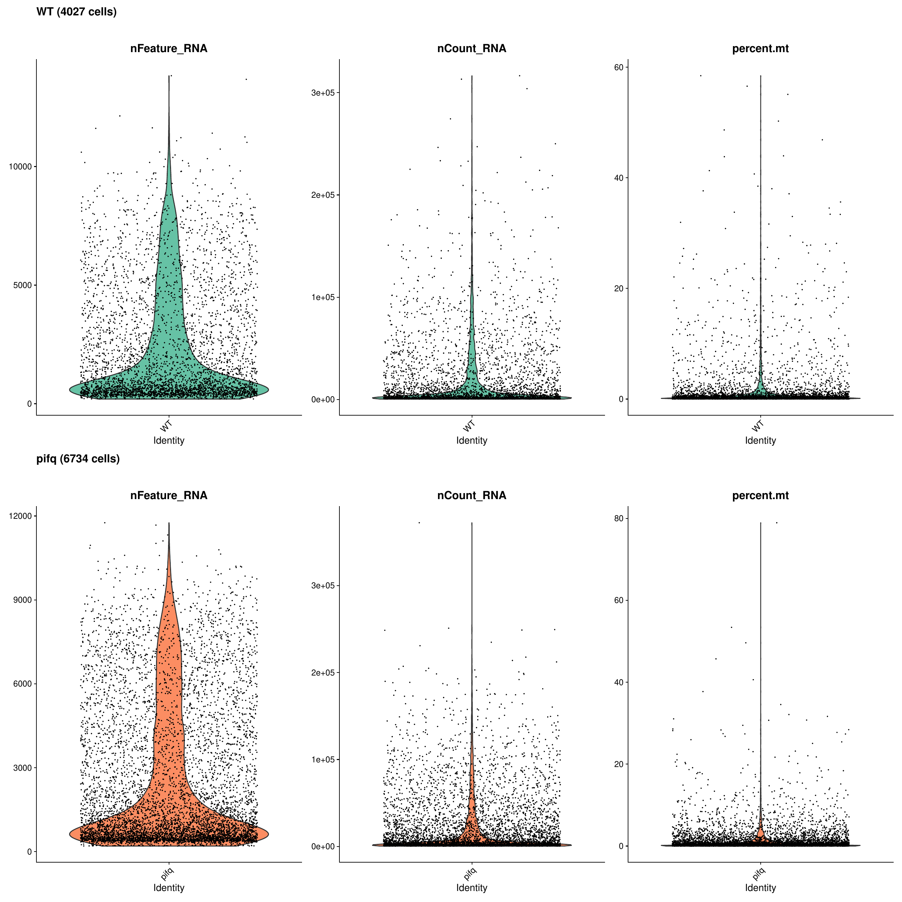{width=30%}

\newpage

## Section 2 - Cell filtering and doublet detection

This section filters low-quality cells, then runs **DoubletFinder** to flag and
remove doublets (droplets that captured two cells instead of one, which would
otherwise show up as a fake intermediate or hybrid cell type). The code shown
here uses two filtering thresholds -- cells must have more than 200 detected
genes (`min_features = 200`) and less than 5% mitochondrial reads (`max_mt =
5`) -- and DoubletFinder runs automatically after that filtering step, since
`run_doubletfinder` defaults to `TRUE` in `filter_sample()`; it is not something
that needs to be added, only disabled if you don't want it (see below).
Internally, this calls `doubletfinder_pipeline()`, which normalizes, scales,
runs PCA, sweeps DoubletFinder's `pK` parameter, and removes any cells it
classifies as doublets.

The filtering function also accepts extra options that are not used in this
example (which filters only by `min_features = 200` and `max_mt = 5`). Their
defaults do not filter anything:

| Option | Default | When to use it | How to choose a value |
|---|---|---|---|
| `max_features` | `Inf` | Cells with far more detected genes than the rest, often doublets | In the pre-filter violin of `nFeature_RNA`, cut where the upper tail separates from the main body of cells (for example, near the 99th percentile) |
| `min_counts` | `0` | Cells with very few UMIs even though they pass `min_features` | Same approach on `nCount_RNA`, at the lower end |
| `max_counts` | `Inf` | Cells with far more UMIs than the rest | Same approach on `nCount_RNA`, at the upper end |
| `run_doubletfinder` | `TRUE` | Set to `FALSE` only to skip doublet detection in a quick test run | Not applicable |

After running the block, the pipeline saves a post-filter QC plot in
`results/01_qc/qc_postfilter.pdf` and stores the filtered sample list in
`results/objects/seurat_list_postfilter.rds`. This saved object is used by the
next section.

```{r section_02_cell_filtering_and_doublet_detection}
output_dir <- dir_01

seurat_list <- filter_seurat_samples(
  seurat_list_raw, min_features = 200, max_mt = 5, run_doubletfinder = TRUE
)

plot_qc_batch(seurat_list, colors, "qc_postfilter.pdf")

saveRDS(seurat_list, file.path(dir_objects, "seurat_list_postfilter.rds"))

message("\nOK SECTION 2 COMPLETE: filtering and doublet detection complete")
```

Representative output from Section 2:

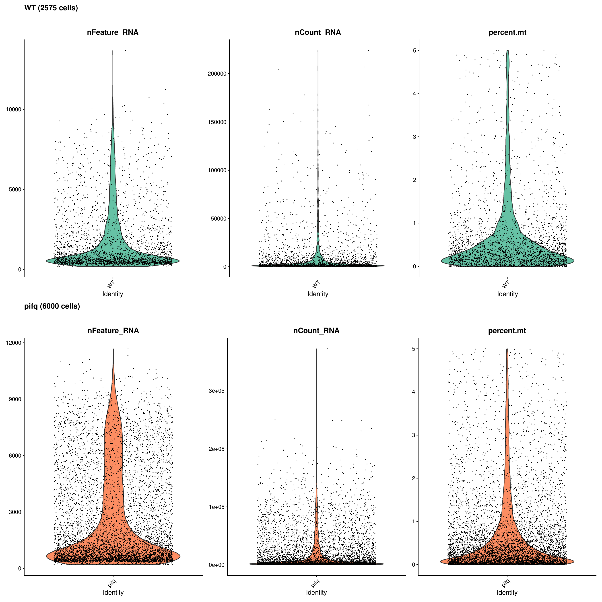{width=30%}

\newpage

## Section 3 - Merge and initial preprocessing

This section merges the two filtered samples into a single Seurat object and runs
the standard preprocessing steps on it. The result is a merged object that has
**not** yet been integrated across samples (that is Section 4).

**What the data look like.** At this point every sample is a matrix with one row
per gene and one column per cell; each entry is the number of transcripts (UMIs)
detected for that gene in that cell. Most entries are zero, so Seurat stores the
matrix in a sparse format and prints zeros as `.`. You can inspect the top-left
corner of the WT matrix yourself (6 genes by 4 cells):

```{r section_03_peek_counts}
GetAssayData(seurat_list[["WT"]], layer = "counts")[1:6, 1:4]
```

**Expected output:**

```text
6 x 4 sparse Matrix of class "dgCMatrix"
          AAACCCAGTGATAGAT-1 AAACCCATCAGTGCGC-1 AAACGAAAGGCAGCTA-1 AAACGAACAAGCGGAT-1
AT1G01010                  .                  .                  .                  .
AT1G01020                  .                  .                  .                  1
AT1G01030                  .                  .                  .                  .
AT1G01040                  .                  .                  .                  .
AT1G01050                  1                  .                  .                  .
AT1G01060                  2                  .                  .                  .
```

Each row is a gene (TAIR identifier) and each column is a cell (identified by its
barcode, with the suffix `-1` added by Cell Ranger). A number is how many
transcripts of that gene were detected in that cell: for example, `AT1G01060`
has 2 in the first cell. A dot means zero. Even in this small corner most
entries are zero, which is typical of single-cell data and the reason the sparse
format is used.

Everything below transforms this matrix. The steps are chained in one pipe, in
this order:

1. **Merge** (`reduce(seurat_list, merge)`) joins the samples into one object
   that keeps the sample of origin of each cell in `orig.ident`.
2. **Normalize** (`NormalizeData`) divides each cell's counts by its total and
   multiplies by 10,000, then log-transforms the result (`LogNormalize`). This
   makes cells with different sequencing depth comparable.
3. **Select highly variable genes (HVGs)** (`FindVariableFeatures`) keeps the
   2,000 genes (`nfeatures = 2000`) whose expression varies most across cells
   after accounting for their average level (`selection.method = "vst"`). Most
   genes are expressed similarly in all cells and add mostly noise; the variable
   ones carry the differences between cell types, so the next steps use only
   them. This is the feature selection step of the workflow.
4. **Scale** (`ScaleData`) centers and scales each selected gene to mean 0 and
   variance 1 (values are capped at 10), so that highly expressed genes do not
   dominate the next step. By default only the HVGs are scaled.
5. **PCA** (`RunPCA(npcs = 30)`) summarizes the scaled HVGs into 30 principal
   components (PCs), new axes that capture the main sources of variation. The
   later steps work on these PCs instead of on thousands of genes.
6. **UMAP** (`RunUMAP(dims = 1:30)`) projects those 30 PCs into two dimensions
   for visualization. It is useful to see how the samples look before Harmony.

**Number of PCs.** By default all 30 PCs are used in every later step (Harmony,
UMAP and clustering use `dims = 1:30`). The elbow plot in this section shows how many
of them carry signal.

**Default parameters used here.** Several important settings are not written in
the code because they are Seurat defaults (Seurat 5.5.1). Change them if your
data call for it:

| Step | Parameter | Value | What it does |
|---|---|---|---|
| `NormalizeData` | `scale.factor` | 10,000 | Total counts per cell after normalization, before the log transform |
| `FindVariableFeatures` | `nfeatures` | 2,000 | Number of HVGs kept (set explicitly here) |
| `ScaleData` | `scale.max` | 10 | Cap on scaled values, to limit the effect of outliers |
| `RunPCA` | `npcs` | 50 | Number of PCs computed; the elbow plot shows how many are informative |
| `RunUMAP` | `n.neighbors` | 30 | Neighbors used to build the map; lower values emphasize local structure |
| `RunUMAP` | `min.dist` | 0.3 | How tightly cells are allowed to pack together in the plot |
| `FindNeighbors` (Section 6) | `k.param` | 20 | Neighbors per cell in the graph used for clustering |

The output is saved as `results/objects/ath_sc_preharmony.rds`, and the UMAP
before Harmony integration is saved as `results/01_qc/umap_preharmony.pdf`.

```{r section_03_merge_and_pca}
output_dir <- dir_01

# Number of PCs to use for UMAP and clustering (adjust based on elbow plot)
PCA_DIMS <- 30

ath_sc <- reduce(seurat_list, merge) %>%
  NormalizeData(verbose = FALSE) %>%
  FindVariableFeatures(
    selection.method = "vst", nfeatures = 2000, verbose = FALSE
  ) %>%
  ScaleData(verbose = FALSE) %>%
  RunPCA(npcs = PCA_DIMS, verbose = FALSE)


# Elbow plot: shows variance explained by each PC to help choose dims for UMAP
save_pdf(plot_elbow(ath_sc, ndims = PCA_DIMS), "elbow_merged.pdf")

message("\nOK SECTION 3 COMPLETE: merge and PCA complete")
```

Representative output from Section 3:

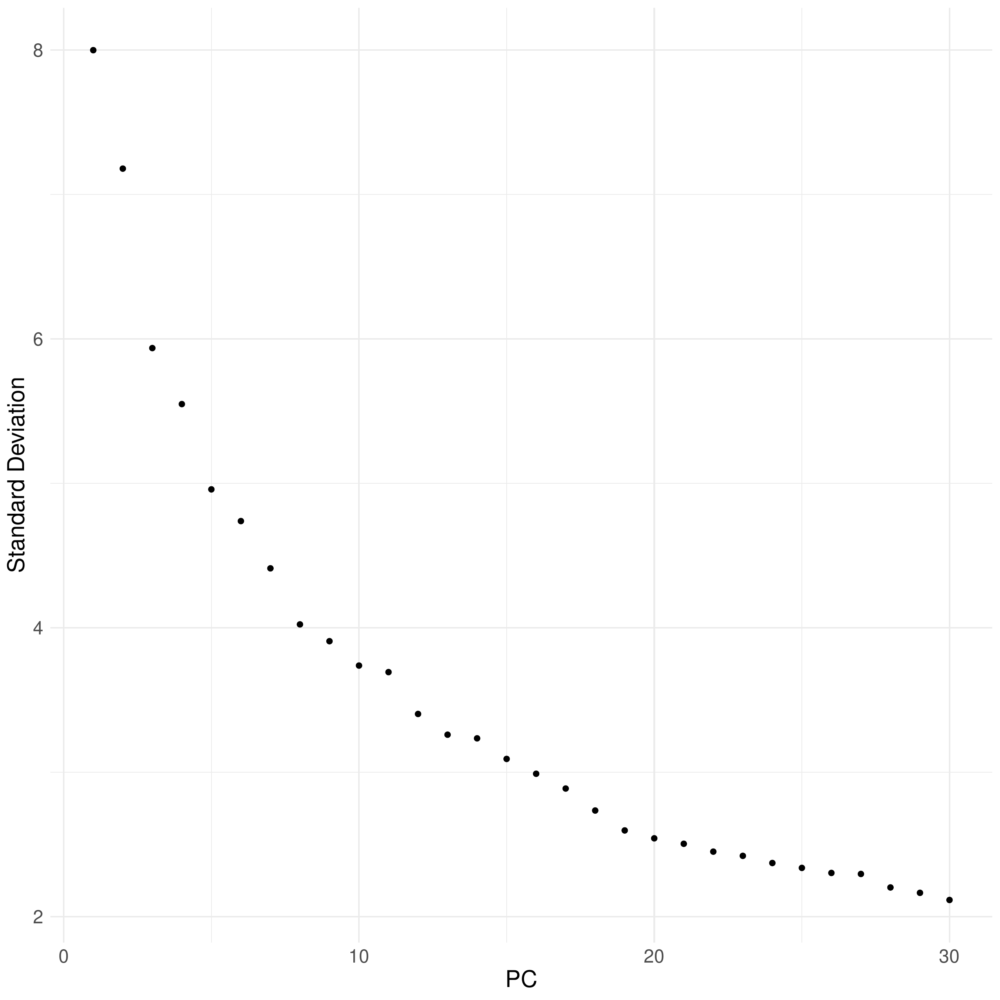{width=40%}

The elbow plot shows how much variance each principal component explains. The
curve typically flattens after the most informative components. Use this to
decide `dims` in Section 4: if the elbow is around PC 15, use `dims = 1:15`;
if it keeps dropping until PC 30, use `dims = 1:30`. For this dataset, we use
`dims = 1:30`.

\newpage

## Section 4 - UMAP pre-Harmony

This section computes the UMAP visualization using the PCA from Section 3. The
number of dimensions (`dims`) should match what you decided from the elbow plot.
This UMAP shows how the samples look *before* Harmony batch correction.

```{r section_04_umap_preharmony}
output_dir <- dir_01

ath_sc <- RunUMAP(ath_sc, reduction = "pca", dims = 1:PCA_DIMS, verbose = FALSE)

save_pdf(
  plot_umap(ath_sc, "orig.ident", colors),
  "umap_preharmony.pdf"
)

saveRDS(ath_sc, file.path(dir_objects, "ath_sc_preharmony.rds"))

message("\nOK SECTION 4 COMPLETE: UMAP pre-Harmony complete")
```

Representative output from Section 4:

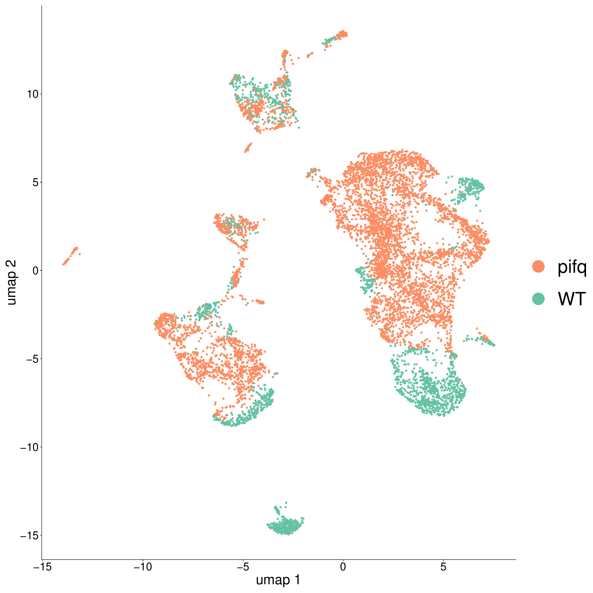{width=40%}

\newpage

## Section 5 - Harmony integration

The two samples in this guide are different genotypes (WT and pifq), so they
differ for biological reasons as well as for technical ones. Left as they are,
cells can cluster by *sample* instead of by *cell type*, which would hide the
cell populations that both samples share. This section applies **Harmony** to
reduce those sample-associated differences in the PCA representation calculated
in Section 3, so that cells of the same type from both samples are placed
together. The correction is done using the sample identity stored in
`orig.ident`.

Harmony is one of several integration methods (others include Seurat's
CCA/RPCA integration, fastMNN, Scanorama and scVI); we use it here because it is
fast, works directly on the PCA embedding and is widely used. Harmony only
changes the embedding used for UMAP and clustering; it does not modify the gene
counts. Because each genotype is a single sample here, Harmony cannot tell
technical differences from genotype effects, so check that the biological
differences you care about are still visible after correction.

After Harmony, the UMAP is recalculated using the corrected representation. This
second UMAP helps check whether samples mix better while still preserving
biological structure.

The corrected object is saved as `results/objects/ath_sc_postharmony.rds`, and
the post-Harmony UMAP is saved as `results/01_qc/umap_postharmony.pdf`.

```{r section_05_harmony_batch_correction}
output_dir <- dir_01

ath_sc <- ath_sc %>%
  RunHarmony("orig.ident", plot_convergence = FALSE) %>%
  RunUMAP(reduction = "harmony", dims = 1:PCA_DIMS, verbose = FALSE)

save_pdf(
  plot_umap(ath_sc, "orig.ident", colors),
  "umap_postharmony.pdf"
)

saveRDS(ath_sc, file.path(dir_objects, "ath_sc_postharmony.rds"))

message("\nOK SECTION 4 COMPLETE: Harmony integration complete")
```

Representative output from Section 4:

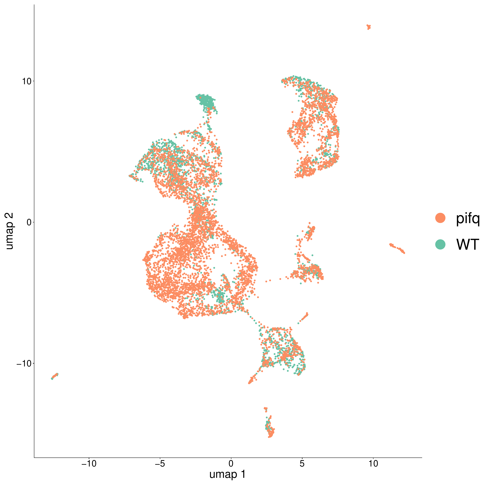{width=30%}

\newpage

## Section 7 - Clustering resolution

This section compares candidate clustering resolutions to help choose the one
used in Section 6. The elbow plot (how many PCs to use) was already shown in
Section 3.

**Clustree.** The clustree compares several candidate clustering resolutions. It
shows, for each resolution in `resolutions_test`, how many clusters it produces
and whether cells stay in stable clusters or keep moving between them as the
resolution changes. A resolution where cell membership stops moving is a safer
choice than one that is still fragmenting. Lower resolutions produce fewer,
broader clusters; higher resolutions produce more, smaller ones. The values in
`resolutions_test` are only the range of candidates to compare; widen or narrow
it if the useful region lies outside it.

The output is saved in `results/02_clustering/` as `clustree.pdf`. Use it to
choose `cluster_resolution` in Section 6.

```{r section_06_resolution_optimization}
resolutions_test <- c(0.15, 0.35, 0.45, 0.55, 1.0)

output_dir <- dir_02

clu <- run_resolution_sweep(
  ath_sc, resolutions = resolutions_test, output_dir = output_dir
)

message("\nOK SECTION 8 COMPLETE: clustree saved")
```

Representative output from Section 5:

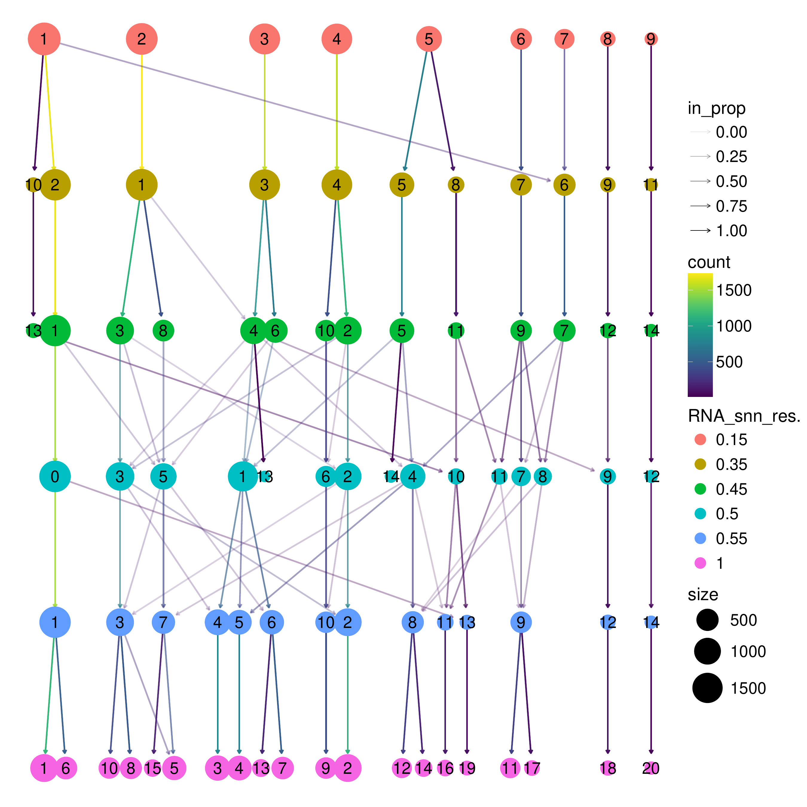{width=40%}

\newpage

## Section 6 - Final clustering

This section groups cells that look transcriptionally similar into discrete
clusters, using the **Leiden algorithm** (`algorithm = 4`) -- a standard
community-detection method for single-cell data. Each cluster is a candidate
cell population; cell-type labels are only assigned afterward, in Section 7.
The resolution is set in `cluster_resolution`, chosen from the clustree in
Section 5. Lower resolutions produce fewer, broader clusters; higher resolutions
produce more, smaller ones. Clustering uses the Harmony dimensions in
`cluster_dims`, which by default are the first 30 (`1:30`); change it only if you
decided on fewer after looking at the elbow plot in Section 5.

The resolution used here is `cluster_resolution <- 0.35`. In the clustree
(Section 5), 0.35 is one of the most stable resolutions: its clusters mostly
trace back to a single cluster of the previous resolution (solid arrows).
Raising the resolution beyond it (0.45 and above) starts to split clusters into
many smaller ones and cells begin to move between branches (the pale crossing
arrows), which would give clusters that are harder to interpret as cell types.
This is a judgment call, not a fixed rule: with another dataset, choose the
resolution where the clustree is stable and the number of clusters still
matches the cell populations you expect.

`FindNeighbors` builds a graph that connects each cell to its `k.param = 20`
nearest neighbors in Harmony space, and `FindClusters` then splits that graph
into communities. A smaller `k.param` gives finer, more local clusters; a larger
one gives smoother, broader ones.

After running this block, each cell receives a final Seurat cluster ID stored in
`seurat_clusters`. These numeric clusters are the starting point for cell-type
annotation in the next section.

The output figure is a UMAP colored by final cluster number, saved as
`results/02_clustering/umap_seuratclusters.pdf`.

```{r section_06_final_clustering}
cluster_resolution <- 0.35
cluster_dims       <- 1:30     # default; fewer dimensions change the UMAP and clusters
output_dir <- dir_02

ath_sc <- ath_sc %>%
  RunUMAP(reduction = "harmony", dims = cluster_dims, verbose = FALSE) %>%
  FindNeighbors(
    reduction = "harmony", dims = cluster_dims, k.param = 20, verbose = FALSE
  ) %>%
  FindClusters(resolution = cluster_resolution, algorithm = 4, verbose = FALSE)

Idents(ath_sc) <- "seurat_clusters"
save_pdf(
  plot_umap(ath_sc, "seurat_clusters"),
  "umap_seuratclusters.pdf"
)

message("\nOK SECTION 8 COMPLETE: final clustering complete")
```

Representative output from Section 6:

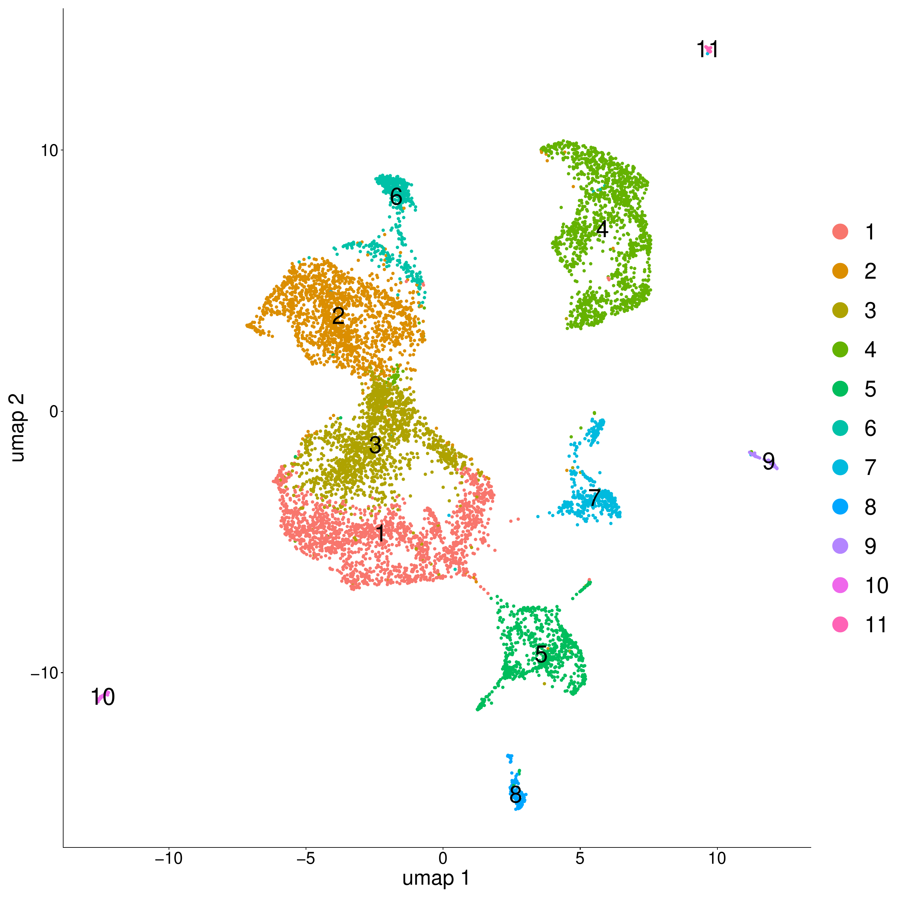{width=30%}

\newpage

## Section 8 - Cell-type annotation

This section assigns biological cell-type labels to the clusters using a marker
gene table from the literature. The marker file is read from
`data/biblio_marks.txt`.

**Marker table format.** The bibliography table (`data/biblio_marks.txt`) lists
known marker genes: `celltype` (the cell type), `symbol` (gene name), and `ID`
(AGI code). Example:

```text
celltype        symbol   ID
guard cell      FAMA     AT3G24140
companion cell  AHA3     AT5G57350
```

**How annotation works.** The pipeline runs `FindAllMarkers()` to find genes
differentially expressed in each cluster. This output is saved to
`results/03_annotation/FindAllMarkers.tsv`:

```text
gene        p_val       avg_log2FC  pct.1  pct.2  p_val_adj  cluster
AT2G39730   1.2e-180    2.45        0.92   0.15   2.8e-176   0
AT1G29930   3.1e-165    1.89        0.88   0.21   7.2e-161   0
AT5G38410   8.4e-142    2.12        0.85   0.18   1.9e-137   0
```

Columns: `gene` (AGI code), `avg_log2FC` (fold change), `pct.1` (% cells in
cluster expressing the gene), `pct.2` (% cells outside), `p_val_adj` (adjusted
p-value). The `pct.1`/`pct.2` columns help identify good markers: high `pct.1`
+ low `pct.2` means the gene is specific to that cluster.

For each cluster, the annotation function finds which bibliography genes are
also significant markers, picks the one with the best p-value, and assigns its
cell type label. If multiple clusters get the same label, a suffix is added
   (e.g., Mesophyll.1, Mesophyll.2).

The dotplot visualizes expression of all bibliography markers across clusters
to verify whether the assigned labels are supported by the expected gene
signatures. The main figures are saved as
`dotplot_marker_table_annotation_biblio.pdf` and `umap_annotation_biblio.pdf`.

```{r section_08_cell_type_annotation}
output_dir <- dir_03

biblio_marks_file <- file.path(DATA_DIR, "data", "biblio_marks.txt")
marker_table <- standardize_marker_table(biblio_marks_file)

markers <- find_markers(
  ath_sc,
  output_file = file.path(output_dir, "FindAllMarkers.tsv"),
  force = TRUE
)

ath_sc <- annotate_by_markers(
  ath_sc, markers,
  reference_file = biblio_marks_file
)

plot_marker_dotplot(
  ath_sc,
  marker_table,
  annot_col = "celltype",
  name_gene = TRUE,
  outfile   = file.path(
    output_dir, "dotplot_marker_table_annotation_biblio.pdf"
  ),
  width = 18, height = 18
)

save_pdf(
  plot_umap(ath_sc, "celltype"),
  "umap_annotation_biblio.pdf"
)

message("\nOK SECTION 8 COMPLETE: cell-type annotation complete")
```

Representative outputs from Section 7:

```{=latex}
\begin{center}
```
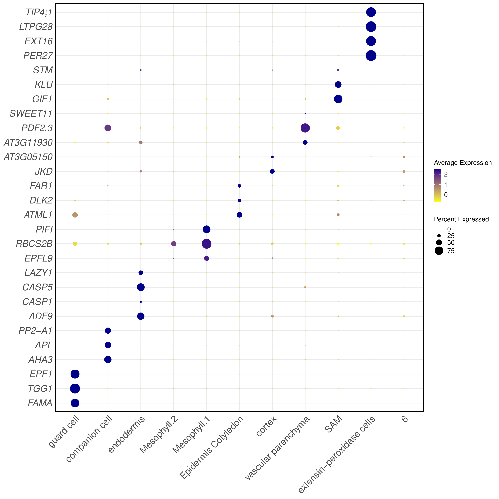{width=30%} 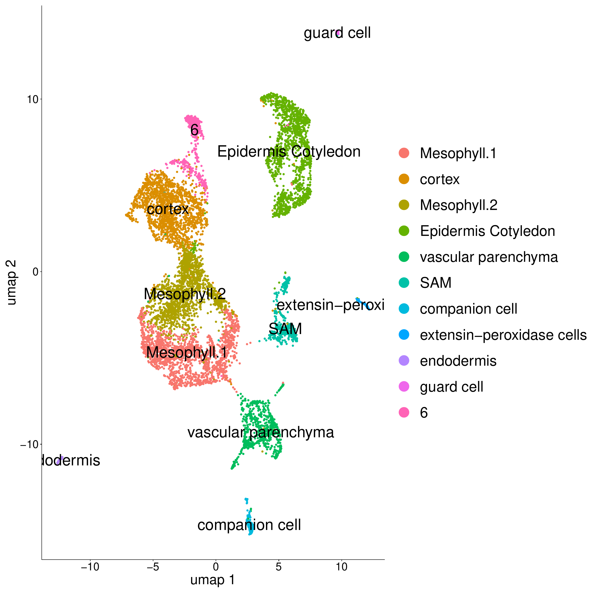{width=30%}
```{=latex}
\end{center}
```

\newpage

## Section 8 - Gene expression visualization

This section plots the expression of one selected gene across the annotated
cell types. The gene to inspect is set in the `gene` variable.

The violin plot shows expression levels by cell type, while the FeaturePlot shows
where the same gene is expressed on the UMAP. These two views are useful for
checking whether a marker or gene of interest matches the expected cell
population.

The outputs are saved in `results/04_expression/` with filenames based on the
selected gene.

```{r section_08_gene_expression_visualization}
gene <- "AT4G21750"   # one gene, or several: c("gen1", "gen2")

output_dir <- dir_04

ath_sc <- JoinLayers(ath_sc)
Idents(ath_sc) <- "celltype"

# Name each file after the plotted gene(s): AT4G21750  ->  ..._AT4G21750.pdf
# c("gen1","gen2") -> ..._gen1_gen2.pdf
gene_tag <- paste(gene, collapse = "_")

save_vln(
  plot_gene_violin(ath_sc, gene),
  paste0("vln_gene_", gene_tag, ".pdf")
)

save_pdf(
  plot_gene_umap(ath_sc, gene),
  paste0("feature_gene_", gene_tag, ".pdf")
)

message("\nOK SECTION 8 COMPLETE: gene expression visualization saved")
```

Representative outputs from Section 8:

```{=latex}
\begin{center}
```
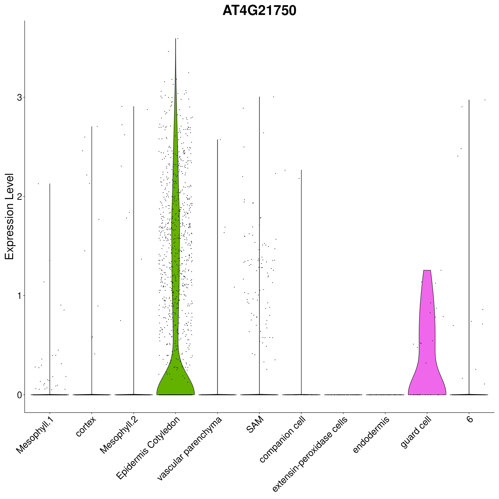{width=30%} 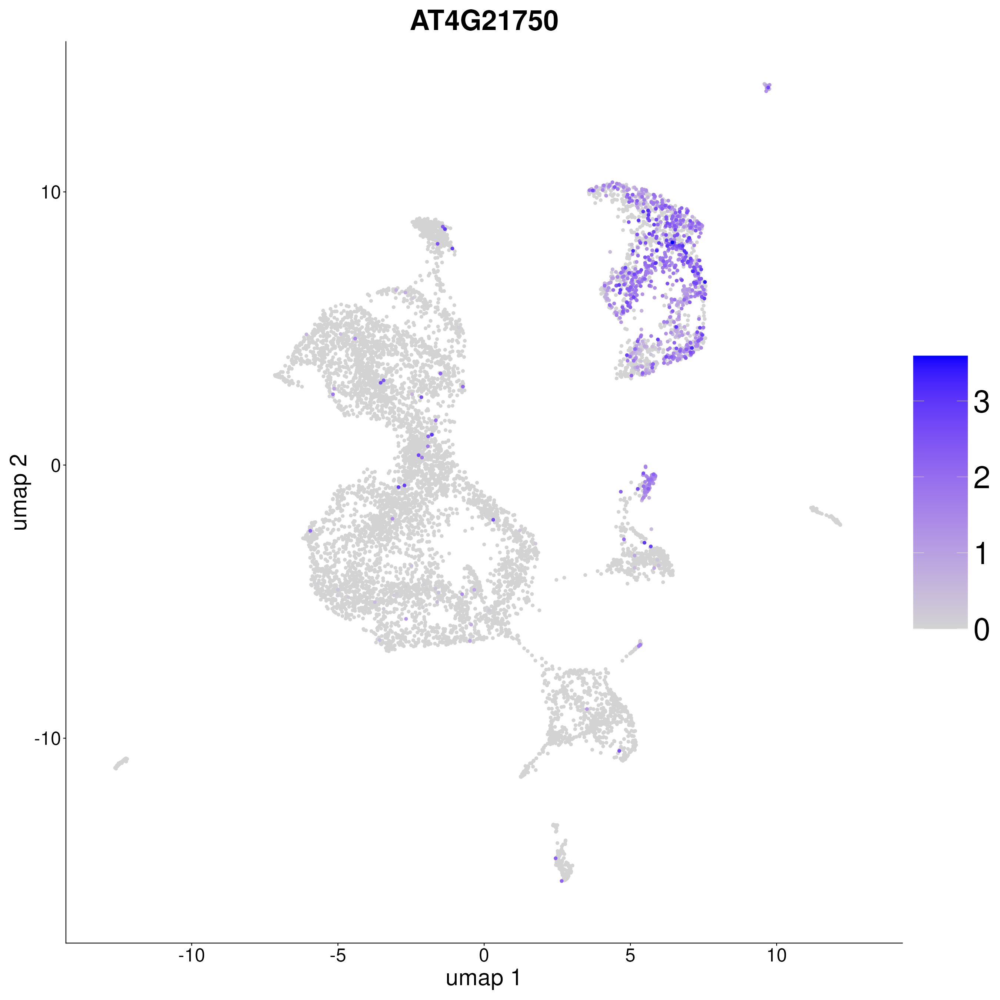{width=30%}
```{=latex}
\end{center}
```

\newpage

## Section 9 - Export the annotated object

This section closes the R part of the workflow by saving the final object in two
formats. The `.rds` file is used to continue working in R, and the `.h5ad` file
is used by the Python sections of the pipeline.

The outputs are saved in `results/objects/` as `ath_sc_annotated.rds` and
`ath_sc_annotated.h5ad`.

```{r section_09_export, strip_comments=FALSE}
# Checkpoint - restore with:
#   ath_sc <- readRDS(file.path(dir_objects, "ath_sc_annotated.rds"))
saveRDS(ath_sc, file.path(dir_objects, "ath_sc_annotated.rds"))

# Export the annotated object to AnnData h5ad format for Python-based
# trajectory and velocity analyses.
export_to_scanpy(
  ath_sc,
  file.path(dir_objects, "ath_sc_annotated.h5ad")
)

# To export a specific cell type only:
# export_to_scanpy(
#   subset(ath_sc, subset = celltype == "guard cell"),
#   file.path(dir_objects, "GuardCell.h5ad")
# )

message("\nOK SECTION 9 COMPLETE: annotated object saved (.rds + .h5ad)")
```

\newpage

# Part 3 - Pseudobulk differential expression and GO

This part continues from the object saved at the end of Part 1. It
aggregates cells into pseudo-replicates per cell type, runs pseudobulk DESeq2
for the WT vs pifq contrast, and summarizes results with volcano plots,
differential tables, GO enrichment, a log2FC heatmap, and co-expression
networks.

```{r part3_load_annotated}
ath_sc <- readRDS(file.path(dir_objects, "ath_sc_annotated.rds"))
```

## Section 10 - Cell-type subsets

The annotation column used to define cell types is a user choice. Depending on
how Part 1 was run, this is one of `celltype` (bibliography annotation),
`celltype_grouped` (broad groups from Supplementary Section S2), or `celltype_curated`
(manual curation from Supplementary Section S3). All downstream sections in this part use
whichever column is set here.

```{r section_10_cell_type_subsets}
pseudobulk_annot_col <- "celltype"

# Inspect how many cells each cell type has before subsetting
table(ath_sc[[pseudobulk_annot_col]])

cell_type_subsets <- create_cell_type_subsets(
  ath_sc, annot_col = pseudobulk_annot_col
)

message("\nOK SECTION 10 COMPLETE: cell-type subsets created")
```

Cells per cell type (annotation `celltype`; Mesophyll is split into two
subclusters, and the still-numeric unannotated cluster `6` is kept separate at
this stage):

| Cell type | Cells |
|---|---:|
| Mesophyll.1 | 1733 |
| cortex | 1697 |
| Mesophyll.2 | 1584 |
| Epidermis Cotyledon | 1568 |
| vascular parenchyma | 751 |
| 6 | 502 |
| SAM | 437 |
| companion cell | 127 |
| extensin-peroxidase cells | 78 |
| endodermis | 67 |
| guard cell | 31 |

## Section 11 - Pseudo-replicate assignment

This section creates pseudo-replicates for the pseudobulk analysis. Instead of
treating each single cell as an independent replicate, cells from the same cell
type and condition are split into a small number of groups. Each group becomes
one pseudo-replicate.

The number of pseudo-replicates is controlled by `n_pseudoreps`. In this report,
`n_pseudoreps = 3`, so each condition inside each cell type is split into three
pseudo-replicates when enough cells are available.

`pseudobulk_conditions` can be left as `NULL` to use all conditions present in
the object, or it can be set to specific conditions if only some groups should be
used. Cell types that do not contain enough information for a comparison, such
as cell types present in only one condition, are removed from the pseudobulk
contrast.

The output is `cell_type_subsets_replicates`, which is the same set of cell-type
subsets but with pseudo-replicate labels added. This object is used in the next
section to build pseudobulk count tables.

```{r section_11_pseudoreplicate_assignment}
pseudobulk_conditions <- NULL
n_pseudoreps          <- 3

cell_type_subsets_replicates <- assign_pseudoreplicates_batch(
  cell_type_subsets,
  pseudobulk_conditions = pseudobulk_conditions,
  n_pseudoreps          = n_pseudoreps
)

# Inspect cells per pseudo-replicate for one cell type
table(cell_type_subsets_replicates[["Epidermis_Cotyledon"]]$replicate)

message("\nOK SECTION 11 COMPLETE: pseudo-replicates assigned")
```

Cell types present in only one condition are dropped, since a WT vs pifq
contrast needs both conditions represented. Here `extensin-peroxidase cells` (78
cells, all from pifq) are dropped, and ten cell types are retained. In
`cell_type_subsets_replicates`, spaces and dots in the cell-type names are
replaced by `_`, so `Epidermis Cotyledon` is `Epidermis_Cotyledon`.

The last line of the block prints the cells in each pseudo-replicate of
`Epidermis_Cotyledon`. Cells are assigned to the groups at random, so the three
groups of one condition have similar sizes, while the two conditions can have very
different numbers of cells (WT has fewer here):

| Cell type | Replicate | Cells |
|---|---|---:|
| Epidermis Cotyledon | pifq_rep1 | 351 |
| Epidermis Cotyledon | pifq_rep2 | 397 |
| Epidermis Cotyledon | pifq_rep3 | 376 |
| Epidermis Cotyledon | WT_rep1 | 155 |
| Epidermis Cotyledon | WT_rep2 | 147 |
| Epidermis Cotyledon | WT_rep3 | 142 |

## Section 12 - Pseudobulk tables and DESeq2

Testing every single cell as its own replicate overstates statistical
confidence, since cells from the same sample are not independent. This
section avoids that by building pseudobulk count tables and running
**DESeq2** -- the standard, widely-cited tool for differential expression
from count data -- for the selected comparisons. For each cell type, counts
from cells belonging to the same pseudo-replicate are summed together,
creating replicate-level count profiles that can be analyzed the same way a
bulk RNA-seq experiment would be.

The comparisons are defined in the `comparisons` list. Each entry contains the
two conditions to compare and a short `tag` used to name the output folder and
files. In this report, the comparison is `WT` versus `pifq`, and the tag is
`WT_vs_pifq`.

`cell_types_to_analyze` can be left as `NULL` to analyze all available cell
types, or set to a selected list if only specific cell types should be tested.

For each cell type and comparison, the pipeline writes a DESeq2 result table with
one row per gene. The main columns are `log2FoldChange`, `pvalue`, and `padj`.
For the `WT_vs_pifq` comparison used here, positive log2FC means higher
expression in `pifq`, while negative log2FC means higher expression in `WT`.

```{r section_12_pseudobulk_deseq2}
comparisons <- list(
  list(conds = c("WT", "pifq"), tag = "WT_vs_pifq")
)
cell_types_to_analyze <- NULL
output_dir <- dir_06

deseq2_results <- run_pseudobulk_deseq2_analysis(
  cell_type_subsets_replicates = cell_type_subsets_replicates,
  comparisons    = comparisons,
  output_dir     = output_dir,
  cell_types     = cell_types_to_analyze,
  pseudobulk_dir = file.path(dir_objects, "pseudobulk_replicates")
)

message("\nOK SECTION 12 COMPLETE: pseudobulk aggregation and DESeq2 complete")
```

One `DESeq2_<cell_type>_WT_vs_pifq.csv` is written per cell type: the standard
DESeq2 results table (one row per gene, with `log2FoldChange`, `pvalue`, and
`padj`). Positive log2FC means higher expression in pifq. First rows of the
Mesophyll table:

```text
             baseMean  log2FoldChange   lfcSE      stat     pvalue      padj
AT1G01010    94.04     -1.659           0.294     -5.652   1.6e-08     1.3e-07
AT1G01020   119.88      0.204           0.168      1.212   2.3e-01     3.6e-01
AT1G01030   417.65     -0.605           0.172     -3.521   4.3e-04     1.8e-03
```

## Section 13 - Volcano plots

This section creates volcano plots from the DESeq2 result tables generated in
Section 15. Each plot summarizes one cell type for the selected comparison.

The `volcano_tag` selects which comparison folder to use. The thresholds
`padj_cut` and `lfc_cut` define which genes are highlighted as significant in
the plots. In this report, genes are highlighted when adjusted p-value is below
0.05 and absolute log2FC is at least 1.

The volcano plots are saved inside the corresponding comparison folder under
`results/06_de_results/`.

```{r section_13_volcano_plots}
volcano_tag <- "WT_vs_pifq"
padj_cut    <- 0.05
lfc_cut     <- 1

render_volcano_plots(
  results_dir = file.path(dir_06, volcano_tag),
  output_dir  = file.path(dir_06, volcano_tag, "volcano"),
  pdf_name    = paste0("VolcanoPlots_", volcano_tag, ".pdf"),
  padj_cut    = padj_cut,
  lfc_cut     = lfc_cut
)

message("\nOK SECTION 13 COMPLETE: volcano plots saved")
```

Representative output from Section 13:

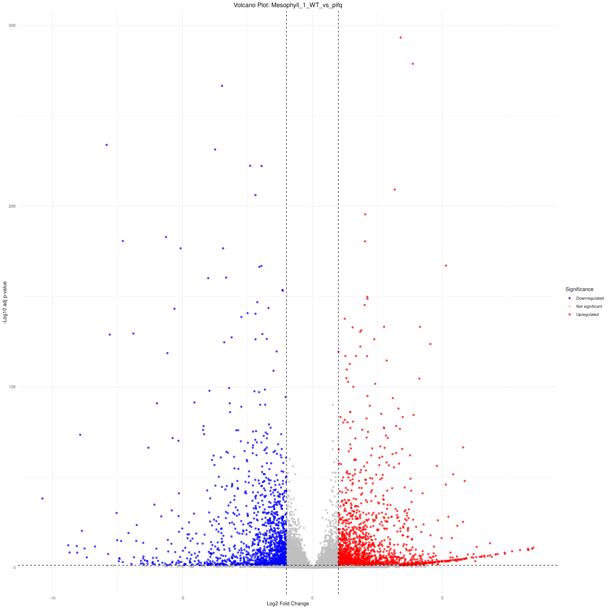{width=30%}

## Section 14 - Differential gene tables

This section summarizes the DESeq2 results into combined differential gene
tables. It uses the same significance thresholds defined for the volcano plots:
`padj_cut` for adjusted p-value and `lfc_cut` for log2 fold-change.

The output makes it easier to compare differential expression across cell types.
One table records whether each gene is significantly upregulated, downregulated,
or not significant in each cell type. A second table stores the corresponding
log2FC values for the significant genes.

These tables are useful for quickly checking which genes are shared across cell
types and which responses are cell-type specific.

```{r section_14_differential_gene_tables}
diff_prefix <- paste0("diff_table_", volcano_tag)

diff_tables <- build_differential_tables(
  results_dir = file.path(dir_06, volcano_tag),
  output_dir  = file.path(dir_06, volcano_tag),
  padj_cut    = padj_cut,
  lfc_cut     = lfc_cut,
  prefix      = diff_prefix
)

message("\nOK SECTION 14 COMPLETE: differential gene tables saved")
```

This writes two combined matrices (genes x cell types). The class matrix
(`diff_table_WT_vs_pifq_*.tsv`) uses `+1`/`-1`/`0` to flag genes up-, down-, or
not significantly regulated in each cell type; the log2FC matrix
(`log2FC_table_*.tsv`) holds the actual fold changes (`NA` where not
significant). Example rows for three annotated cell types (Epidermis
Cotyledon, Mesophyll, PHLOEM):

```text
# class matrix                          # log2FC matrix
gene_id    EpiCot  Meso  Phlo          gene_id    EpiCot   Meso   Phlo
AT1G01010    -1     -1     0          AT1G01010    -1.90   -1.66    NA
AT1G01060     1      1     0          AT1G01060     1.47    4.55    NA
AT1G01120    -1      1     0          AT1G01120    -1.72    1.22    NA
```

## Section 15 - GO enrichment

This section tests whether the significant genes from each cell type are
enriched for Gene Ontology terms. In simple terms, it asks whether the genes that
change between conditions are concentrated in particular biological processes,
functions, or cellular components.

The `go_space` variable selects which GO category to use. Here it is set to
`BP`, meaning Biological Process. The organism database is set with `go_orgdb`,
and `go_keytype` tells the function which gene identifier format is being used.
For this Arabidopsis report, the database is `org.At.tair.db` and the key type is
`TAIR`.

The adjusted p-value cutoff is controlled by `padj_cutoff`. The GO result tables
and bubble plots are saved in `results/07_go/` under the selected comparison
name.

```{r section_15_go_enrichment}
go_space    <- "BP"
go_orgdb    <- org.At.tair.db
go_keytype  <- "TAIR"
padj_cutoff <- 0.05

go_results <- run_go_enrichment_for_contrast(
  results_dir  = file.path(dir_06, volcano_tag),
  output_dir   = file.path(dir_07, volcano_tag),
  orgdb        = go_orgdb,
  keytype      = go_keytype,
  go_space     = go_space,
  padj_cutoff  = padj_cutoff,
  contrast_tag = volcano_tag
)

message("\nOK SECTION 15 COMPLETE: GO enrichment complete")
```

Representative output from Section 15:

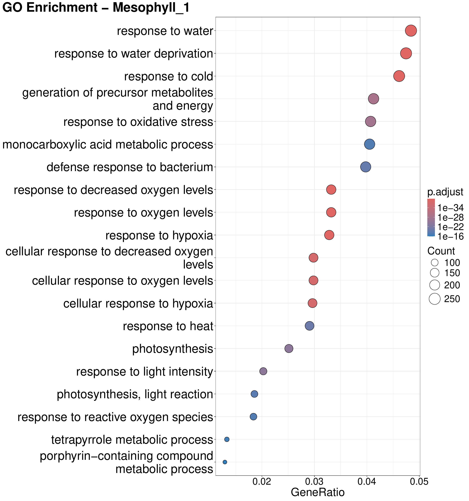{width=30%}

## Section 16 - Log2FC heatmap

This section turns the differential expression tables into a heatmap of log2FC
values. It is used to compare how strongly genes change across cell types in the
same condition contrast.

Rows are genes and columns are cell types. Genes with similar cross-cell-type
patterns are grouped together. The `heatmap_limits` value controls the color
scale; in this report it is set from -5 to 5 so strong negative and positive
changes are shown on the same scale.

The heatmap is saved in the comparison folder inside
`results/06_de_results/`.

```{r section_16_log2fc_heatmap}
heatmap_limits <- c(-5, 5)

build_logfc_heatmap(
  logfc_table  = diff_tables$logfc,
  contrast_tag = volcano_tag,
  output_dir   = file.path(dir_06, volcano_tag),
  limits       = heatmap_limits,
  cell_order   = unique(marker_table$cell.types)
)

message("\nOK SECTION 16 COMPLETE: log2FC heatmap saved")
```

Representative output from Section 16:

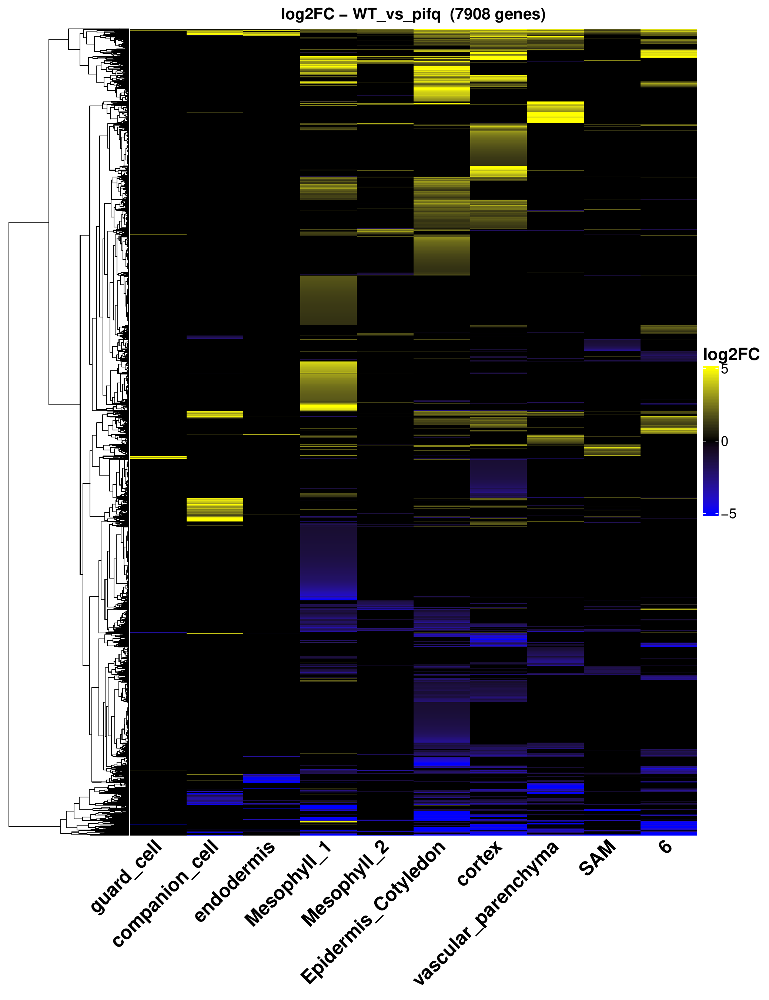{width=30%}

\newpage

## Section 17 - Gene-gene co-expression network (hdWGCNA) and TF network

This section builds a gene-gene co-expression network with **hdWGCNA**
(high-dimensional weighted gene co-expression network analysis; Morabito et al.,
2023, *Cell Reports Methods*), the single-cell version of WGCNA (Langfelder and
Horvath, 2008, *BMC Bioinformatics*). The network is built from the significant
differentially expressed genes and then focused on transcription factor (TF)
connections. The TF list comes from `data/AtTFDB_loci.txt`, which was prepared
from AtTFDB, the Arabidopsis transcription factor database available through
AGRIS: https://agris-knowledgebase.org/.

hdWGCNA works in four steps. It groups similar cells into **metacells** to reduce
the sparsity of single-cell counts, chooses a **soft-thresholding power** that
gives a network with a scale-free-like structure, computes the **topological
overlap matrix (TOM)** between genes, and detects **modules** of co-expressed
genes. The TOM value is the weight of each gene-gene edge.

The main input is the log2FC table produced in Section 17. The wrapper function
`run_hdwgcna_tf_network()` (its name says which method it runs) takes the Seurat
object, the differential expression results and the annotation column, runs
hdWGCNA, keeps the strong gene-gene edges, and draws the TF network colored by
differential expression direction.

The parameters near the end of the call control practical details: the number of
metacells, the minimum module size, the edge-strength threshold (a minimum TOM
weight) and how many hub TFs are labeled. The network output is saved in
`results/08_networks/`.

Besides the figure, the function exports the TF-target interaction file
`TF_TARGET_interaccion.tsv` to `results/08_networks/`. It has three columns,
`TF`, `TARGET` and `weight` (the TOM value), and it keeps only the gene pairs
with at least one TF whose weight reaches `tom_threshold`. This is the file to
import into Cytoscape (File > Import > Network from File, with `TF` as source
node, `TARGET` as target node and `weight` as edge attribute). The network drawn
in R is only a basic visualization made with the `igraph` and `ggraph`
packages; for a final figure, build the network from the interaction file in
Cytoscape. Co-expression has no direction: `TF` and `TARGET` only tell which
gene of the pair is the transcription factor (when both are TFs, the order is
arbitrary).

The file is tab-separated, one interaction per row. These are its first rows
(columns aligned here for reading):

```
TF         TARGET     weight
AT1G01380  AT4G36250  0.200217019734875
AT1G01720  AT5G59820  0.230731043800715
AT1G01720  AT5G08790  0.228962029137792
AT1G01720  AT5G63790  0.222149570169148
AT1G01720  AT1G76600  0.222010840386788
```

```{r section_17_tf_coexpression_network}
run_hdwgcna_tf_network(
  seurat_obj      = ath_sc,
  de_table_path   = file.path(dir_06, volcano_tag, "log2FC_table_fc1_padj_005.tsv"),
  tf_list_path    = file.path(DATA_DIR, "data", "AtTFDB_loci.txt"),
  output_dir      = dir_08,
  annot_col       = pseudobulk_annot_col,
  contrast_tag    = volcano_tag,
  n_metacells     = 50,     # metacells per cell type x sample
  min_module_size = 20,     # minimum genes per co-expression module
  deep_split      = 2,      # module-splitting sensitivity (0-4)
  soft_power      = NULL,   # NULL = auto-detect the soft power
  tom_threshold   = 0.2,    # minimum TOM weight to keep an edge
  n_hub_label     = 15      # number of top hub TFs to label
)

message("\nOK SECTION 17 COMPLETE: TF coexpression network saved")
```

Representative output from Section 17:

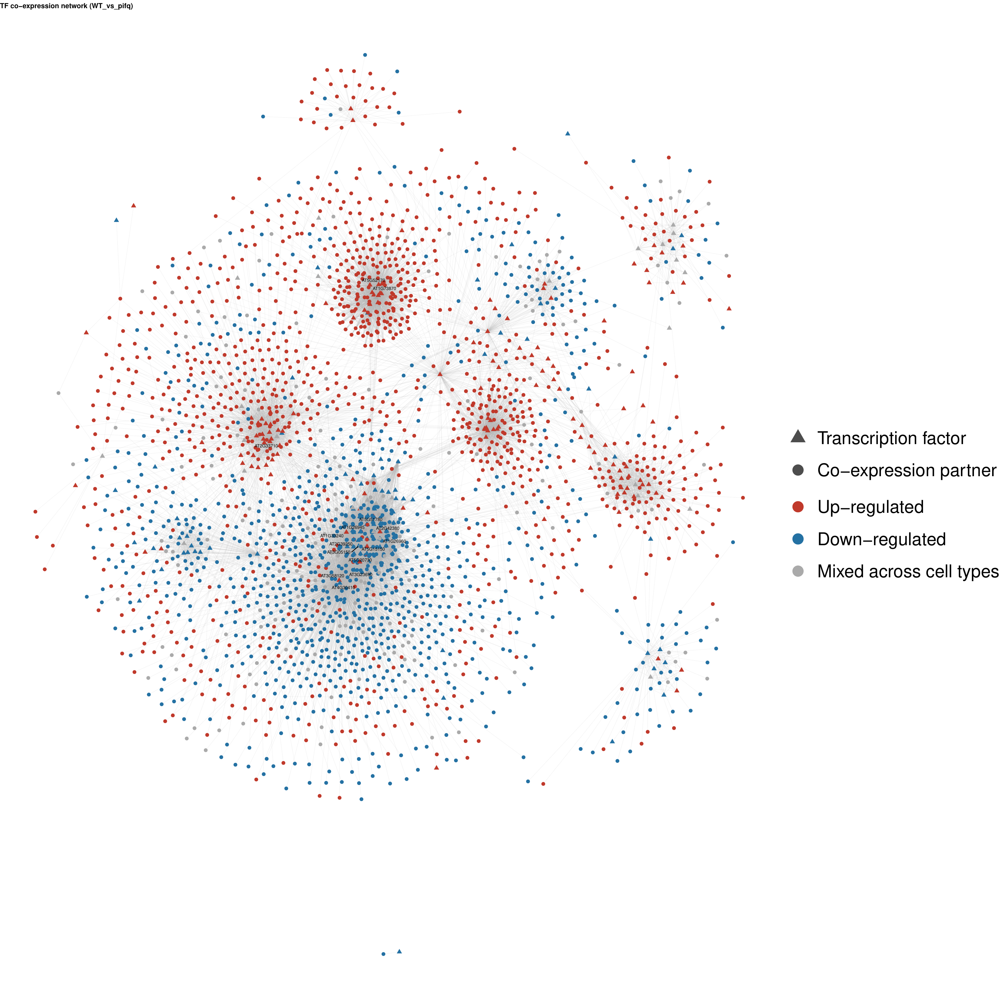{width=30%}

\newpage

# Part 4 - Pseudotime trajectory analysis (Python)

Part 4 runs in Python (scanpy, Palantir, scFates), starting from the h5ad
object exported at the end of Part 1
(`results/objects/ath_sc_annotated.h5ad`). Exit R and start Python
inside the same container:

```bash
q()          # leave R (do not save the workspace)
python3
```

## Section 18 - Setup

This section starts the Python part of the pipeline. It defines the same project
paths used earlier, loads the Python helper scripts, and creates the pseudotime
output folder.

Use this block first after leaving R and starting Python inside the
container. After it runs, the functions needed for trajectory analysis are
available in the Python session.

```{python section_18_setup, eval=FALSE}
import os

PIPELINE_DIR = "/workspace/workflow"
DATA_DIR     = "/workspace/."
base_dir     = os.path.join(DATA_DIR, "results")

exec(open(os.path.join(PIPELINE_DIR, "load_libraries_python.py")).read(), globals())
exec(open(os.path.join(PIPELINE_DIR, "ScRNA_Pseudotime_Functions.py")).read(), globals())

dir_pseudotime = os.path.join(base_dir, "09_pseudotime")
os.makedirs(dir_pseudotime, exist_ok=True)

print("SECTION 18 COMPLETE: setup done")
```

\newpage

## Section 19 - Load annotated object

This section loads the `.h5ad` object exported at the end of the R workflow. The
`INPUT_H5AD` path points to that file, and `ANNOTATION_COL` selects which cell
type annotation column will be used for plotting and selecting cells.

Up to three annotation columns can be present, depending on which optional
(supplementary) steps were run in Step 1:

- `celltype` -- the direct output of Section 7 (bibliography-marker annotation).
  The rawest of the three, and always present.
- `celltype_grouped` -- present only if Supplementary Section S2 was run. Same as `celltype`,
  but with related subclusters merged into a single label (e.g. the two
  mesophyll subclusters collapsed into one).
- `celltype_curated` -- present only if Supplementary Section S3 was run. The manually
  curated annotation, built by inspecting and relabeling subclusters.

Set `ANNOTATION_COL` to whichever of these matches how far the optional steps
went in Step 1: `celltype` if Supplementary Sections S2 and S3 were skipped,
`celltype_grouped` if only Supplementary Section S2 was used, and
`celltype_curated` if Supplementary Section S3 was used.

The example below uses `celltype`. With the current marker table the cotyledon
epidermis is a single label, `Epidermis Cotyledon`, which is the one used in
Sections 20 and 21.

The function also standardizes coordinate names so the object works cleanly with
Scanpy. It prints the annotation columns available in the loaded object -- use
this to confirm `ANNOTATION_COL` is set correctly -- then saves an overview UMAP
and prints the available cell types, which are used to choose the trajectory
cells in the next section.

```{python section_19_load_object, eval=FALSE}
INPUT_H5AD     = "/workspace/results/objects/ath_sc_annotated.h5ad"
# "celltype" (Section 7) is always present. Switch to "celltype_grouped" if
# Supplementary Section S2 was used, or "celltype_curated" if Supplementary Section S3 was used.
ANNOTATION_COL = "celltype"
N_JOBS         = 4

adata, N_JOBS = load_curated_object(
    input_h5ad     = INPUT_H5AD,
    dir_pseudotime = dir_pseudotime,
    annotation_col = ANNOTATION_COL,
    n_jobs         = N_JOBS,
)
```

Representative output from Section 19:

{width=30%}

\newpage

## Section 20 - Cell type selection

This section selects which cell types will be used for trajectory inference. The
list is set in `TRAJECTORY_CLUSTERS`, and the names must match the cell-type
labels printed in Section 19.

In this report, only the cotyledon epidermis is selected. With the current marker
table it is a single label, `Epidermis Cotyledon`. The preview UMAP shows these
cells before fitting the trajectory, which helps confirm that the intended
population was chosen. If you used the optional grouping or curation
(Supplementary Sections S2 and S3), set `ANNOTATION_COL` in Section 19 to that
column and use its labels here.

```{python section_20_cell_selection, eval=FALSE}
TRAJECTORY_CLUSTERS = ["Epidermis Cotyledon"]

adata_sub = preview_trajectory_selection(
    adata          = adata,
    clusters       = TRAJECTORY_CLUSTERS,
    annotation_col = ANNOTATION_COL,
    dir_pseudotime = dir_pseudotime,
)

print("SECTION 20 COMPLETE: cell type selection saved")
```

Representative output from Section 20:

{width=30%}

\newpage

## Section 21 - Trajectory inference

This section fits the pseudotime trajectory for the selected cells and sets its
root (starting point). A trajectory tree has no intrinsic direction — the start
must be defined based on biological knowledge.

**Root selection logic.** The default method (`root_method = "auto"`) places the
root at the tree tip with the highest mean number of detected genes per cell
(`nFeature_RNA`). This follows Gulati et al. (2020), who showed that
transcriptional diversity (number of expressed genes) is a hallmark of
developmental potential — less differentiated cells express more genes, making
them good candidates for the trajectory root. When multiple cell types are
present, only cells from `ROOT_CLUSTER` are considered for scoring, so the root
is placed within that cell type.

| Method | Description |
|--------|-------------|
| `"auto"` | Default. Uses Gulati score; when multiple cell types, restricts to `ROOT_CLUSTER`. |
| `"tip"` | Manual override. Set `root_tip` to a node number (see Supplementary Section S4). |

To customize, use `root_score` (a gene ID or obs column) or `root_lowest = TRUE`
(for an end-state marker where low expression marks the root).

**Reference:** Gulati GS et al. (2020) Single-cell transcriptional diversity is
a hallmark of developmental potential. *Science* 367(6476):405-411.

`TRAJECTORY_RUNS` stores the trajectory settings to test. Each run creates its
own output folder, making it possible to compare parameter choices without
overwriting previous results.

| Parameter | Default | Description |
|-----------|---------|-------------|
| `nodes` | 100 | Number of nodes in the principal tree. More nodes capture finer structure but risk overfitting noise. |
| `sigma` | 0.1 | Bandwidth for the elastic energy term. Lower values make the tree more rigid; higher values allow more flexibility. |
| `lambda_value` | 20 | Regularization strength. Higher values produce smoother, less branched trees. |
| `eigs` | 3 | Number of diffusion components used before fitting the trajectory. Captures the main axes of variation. |
| `seed` | 3 | Random seed for reproducibility. |

Here, `eigs = 3` means that three diffusion components are used before fitting
the trajectory. The outputs include the trajectory graph, pseudotime
visualization, and root cell plot inside `results/09_pseudotime/`.

```{python section_21_trajectory, eval=FALSE}
# ROOT_CLUSTER is the root cell type when the trajectory has two or more cell
# types. With a single cell type, as here, the root is set automatically at the
# tip of the tree with the most detected genes (root_score, root_lowest,
# root_tip and root_method of run_trajectory_runs() change it).
ROOT_CLUSTER = "Epidermis Cotyledon"

TRAJECTORY_RUNS = [
    trajectory_run(nodes=100, sigma=0.1, lambda_value=20, eigs=3, seed=3),
]

adata_traj, selected_trajectory_dir, trajectory_runs = run_trajectory_runs(
    adata           = adata,
    clusters        = TRAJECTORY_CLUSTERS,
    root_cluster    = ROOT_CLUSTER,
    annotation_col  = ANNOTATION_COL,
    output_base_dir = dir_pseudotime,
    runs            = TRAJECTORY_RUNS,
)

print("SECTION 21 COMPLETE: trajectory inference saved")
```

\newpage

Representative outputs from Section 21 for the epidermis-cotyledon-only trajectory using
`nodes=100`, `sigma=0.1`, `lambda=20`, and `eigs=3`:

{width=85%}

{width=85%}

{width=85%}

```{=latex}
\clearpage
```

## Section 22 - Plot genes on trajectory

This section plots the expression of a selected gene on the fitted epidermis
cotyledon trajectory. `plot_genes_on_trajectory()` takes the genes (and optional
panel titles), so changing `genes` is the only thing needed to inspect another
gene. The figure is saved automatically in the run folder (`gene_plots/`), named
with `filename` or, by default, after the plotted genes joined with `_`, and the
path is printed. The cells with the highest expression are drawn on top
(`sort_order = TRUE`, the equivalent of `order = TRUE` in Seurat), so they are not
hidden by the cells that do not express the gene.

This section is focused on **ATML1**, a marker of the epidermis and the gene used
as the example throughout this report. In the count matrix ATML1 is stored as the
locus `AT4G21750`, so the code uses `AT4G21750` while the panel title shows the
gene name followed by the locus. The plot shows where ATML1 expression falls on
the epidermis cotyledon trajectory layout.

```{python section_22_gene_plots, eval=FALSE}
plot_genes_on_trajectory(
    adata_traj,
    genes    = ["AT4G21750"],                         # ATML1
    titles   = ["ATML1 (AT4G21750)"],
    run_dir  = selected_trajectory_dir,
    filename = "trajectory_genes_ATML1.pdf",
)

print("SECTION 22 COMPLETE: gene trajectory plots saved")
```

Representative output from Section 22:

```{=latex}
\begin{center}
\includegraphics[width=0.6\linewidth]{assets/pseudotime_gene_plots_ATML1.pdf}
\end{center}
```

ATML1 (`AT4G21750`) expression on the epidermis cotyledon trajectory.

```{=latex}
\clearpage
```

## Section 23 - Gene trends

This section fits gene-expression trends along pseudotime for the epidermis
cotyledon trajectory calculated above. It runs in two steps. `compute_gene_trends()`
tests genes for association with pseudotime and fits smooth expression curves; this
is the slow part (about 15 minutes), and its result is saved in
`gene_trends/gene_trends_fitted.h5ad` inside the trajectory run folder, so the next
call loads it instead of recomputing. `plot_gene_trends()` ranks the genes by their
trend signal and draws the trend heatmaps; it takes seconds, so `TOP_N`,
`HIGHLIGHT_GENES` or `ORDERING` can be changed and only this step run again.

For this report, the run shown here uses the already selected epidermis
cotyledon trajectory: `nodes=100`, `sigma=0.1`, `lambda=20`, `eigs=3`, and
`seed=3`. `TOP_N = 10` labels the top 10 most variable genes along pseudotime.
`HIGHLIGHT_GENES = ["AT4G21750"]` highlights ATML1 using the same fitted trend workflow. ATML1
is significant, so it is already part of the fit. A highlighted gene that is not in the saved fit
(it was not significant when the fit was computed) is fitted on its own and added to it, which
takes seconds.

```{python section_23_gene_trends, eval=FALSE}
TOP_N           = 10
HIGHLIGHT_GENES = ["AT4G21750"]
ORDERING        = "max"
SPLINE_DF       = 3

# selected_trajectory_dir points to the epidermis cotyledon run:
# results/09_pseudotime/trajectory/n100_s0.1_l20_e3_seed3
name = os.path.basename(selected_trajectory_dir)

ensure_expression_in_X(adata_traj)

# Step 1 - compute (slow, ~15 min); saved and reused on the next call
adata_fitted = compute_gene_trends(
    adata        = adata_traj,
    run_dir      = selected_trajectory_dir,
    name         = name,
    custom_genes = HIGHLIGHT_GENES,
    n_jobs       = N_JOBS,
    spline_df    = SPLINE_DF,
)

# Step 2 - plot (seconds); rerun only this call after changing the settings
top_path, highlight_path = plot_gene_trends(
    adata_fitted,
    run_dir      = selected_trajectory_dir,
    name         = name,
    custom_genes = HIGHLIGHT_GENES,
    top_n        = TOP_N,
    ordering     = ORDERING,
)

# Step 3 - single gene plot (expression over pseudotime for one gene)
for gene in HIGHLIGHT_GENES:
    plot_single_gene_trend(adata_fitted, gene, selected_trajectory_dir)

print("SECTION 23 COMPLETE: epidermis cotyledon gene trends saved")
```

Representative outputs from Section 23 — epidermis cotyledon gene trends:

```{=latex}
\begin{center}
\includegraphics[width=0.48\linewidth]{assets/pseudotime_gene_trends.pdf}
\hfill
\includegraphics[width=0.48\linewidth]{assets/pseudotime_gene_trends_highlight.pdf}
\end{center}
```

Left: 10 variable genes spread along pseudotime for the epidermis cotyledon trajectory.
Right: ATML1 (`AT4G21750`) highlighted from the same fitted trend workflow.

## Section 24 - Final export

This section saves the final pseudotime object after trajectory inference and
gene-trend analysis. The exported `.h5ad` file keeps the trajectory results,
pseudotime values, and layout coordinates for later reuse.

The final object is saved in `results/objects/` as
`ath_sc_pseudotime_final.h5ad`.

```{python section_24_final_export, eval=FALSE}
final_h5ad = os.path.join(base_dir, "objects", "ath_sc_pseudotime_final.h5ad")
os.makedirs(os.path.dirname(final_h5ad), exist_ok=True)
adata_traj.write_h5ad(final_h5ad)

print(f"SECTION 24 COMPLETE: final pseudotime object saved -> {final_h5ad}")
```

This is the last step of the pipeline. Leave the Python REPL the same way
Part 4 started -- by exiting it explicitly, mirroring `q()` on the R side:

```bash
exit()        # leave Python
```
```{=latex}
\newpage
```

# Output layout {-}

All four parts write into the same `results/` folder inside the cloned
repository (mounted as `/workspace/results` in the container), one
subfolder per step. After running the full pipeline once, it looks like
this:

```{=latex}
\scriptsize
```
```text
results/
|-- 01_qc/
|   |-- qc_prefilter.pdf
|   |-- qc_postfilter.pdf
|   |-- umap_preharmony.pdf
|   `-- umap_postharmony.pdf
|-- 02_clustering/
|   |-- elbow_plot.pdf
|   |-- clustree.pdf
|   `-- umap_seuratclusters.pdf
|-- 03_annotation/
|   |-- FindAllMarkers.tsv
|   |-- dotplot_marker_table_annotation_biblio.pdf
|   |-- umap_annotation_biblio.pdf
|   `-- clustree_annotated.pdf
|-- 04_expression/
|   |-- feature_gene_<gene>.pdf
|   `-- vln_gene_<gene>.pdf
|-- 05_curation/
|   |-- umap_grouped.pdf
|   |-- subcluster_markers_<cluster>.pdf
|   `-- umap_curated.pdf
|-- objects/                              # checkpoints (.rds / .h5ad)
|   |-- seurat_list_postfilter.rds
|   |-- ath_sc_preharmony.rds
|   |-- ath_sc_postharmony.rds
|   |-- ath_sc_annotated.rds
|   |-- ath_sc_annotated.h5ad
|   |-- pseudobulk_replicates/
|   `-- ath_sc_pseudotime_final.h5ad
|-- 06_de_results/<comparison_tag>/       # e.g. WT_vs_pifq/
|   |-- DESeq2_<cell_type>_<tag>.csv
|   |-- <cell_type>_<tag>_filtered.csv
|   |-- diff_table_<tag>_fc1_padj_005.tsv
|   |-- log2FC_table_fc1_padj_005.tsv
|   |-- heatmap_<tag>.pdf
|   `-- volcano/
|       |-- DESeq2_<cell_type>_<tag>.png
|       `-- VolcanoPlots_<tag>.pdf
|-- 07_go/<comparison_tag>/
|   |-- GO_<cell_type>_<tag>_BP.tsv
|   `-- GO_<cell_type>_<tag>_BP_bubble.pdf
|-- 08_networks/
|   |-- TF_TARGET_interaccion.tsv
|   |-- edges_unified.tsv
|   |-- nodes_unified.tsv
|   |-- modules_unified.tsv
|   |-- hubgenes_unified.tsv
|   |-- hdwgcna_summary.tsv
|   |-- unified_TOM.rda
|   |-- hdwgcna_unified.rds
|   `-- network_tf_DE_direction.pdf
`-- 09_pseudotime/
    |-- umap_overview.pdf
    |-- umap_selection.pdf
    `-- trajectory/<run_name>/            # e.g. n100_s0.1_l20_e3_seed3/
        |-- parameters.tsv
        |-- <run_name>_annotation.pdf
        |-- <run_name>_pseudotime_trajectory.pdf
        |-- <run_name>_root_cell.pdf
        |-- <run_name>_pseudotime_by_cell.tsv
        |-- <run_name>_trajectory.h5ad
        |-- gene_plots/trajectory_gene_<gene>.pdf
        `-- gene_trends/
            |-- step29_gene_trends_top10_FINAL_24x18.pdf
            `-- step29_gene_trends_highlight_list_FINAL_24x18.pdf
```

`01_qc`-`05_curation` and `objects/` come from Part 2 (`step1_singlecell.R`);
`06_de_results`/`07_go` (one subfolder per `comparisons` tag, Section 12) and
`08_networks` from Part 3 (`step2_degs.R`); `09_pseudotime` from Part 4
(`step3_pseudotime.py`), one `trajectory/<run_name>/` per entry in
`TRAJECTORY_RUNS` (Section 21). `<gene>`, `<cluster>`, `<cell_type>`, and
`<tag>` depend on the values used when running each section, not on fixed
names.
```{=latex}
\normalsize
```

\newpage

# Supplementary methods {-}

The three steps below are optional. They start from the annotation of Section 7
and write their results to separate columns (`celltype_grouped`,
`celltype_curated`) or figures, so the main workflow runs without them. If you
use one of them, set the annotation column of Supplementary Section S2 accordingly. The code is
also available in `workflow/step1_supplementary.R`.

## Supplementary Section S1 - Annotated clustree {-}

This section adds the cell-type labels from Section 7 onto the clustering tree
from Section 5. Instead of showing only numeric clusters, each node is labeled
with the most common cell type found in that cluster.

This makes it easier to see how stable the annotated cell types are across
different clustering resolutions. The output is saved as
`results/03_annotation/clustree_annotated.pdf`.

```{r supp_s1_annotated_clustree}
output_dir <- dir_03

plot_annotated_clustree(
  ath_sc, clu, annot_col = "celltype", output_dir = output_dir
)

message("\nOK SUPPLEMENTARY S1 COMPLETE: annotated clustree saved")
```

Representative output from Supplementary Section S1:

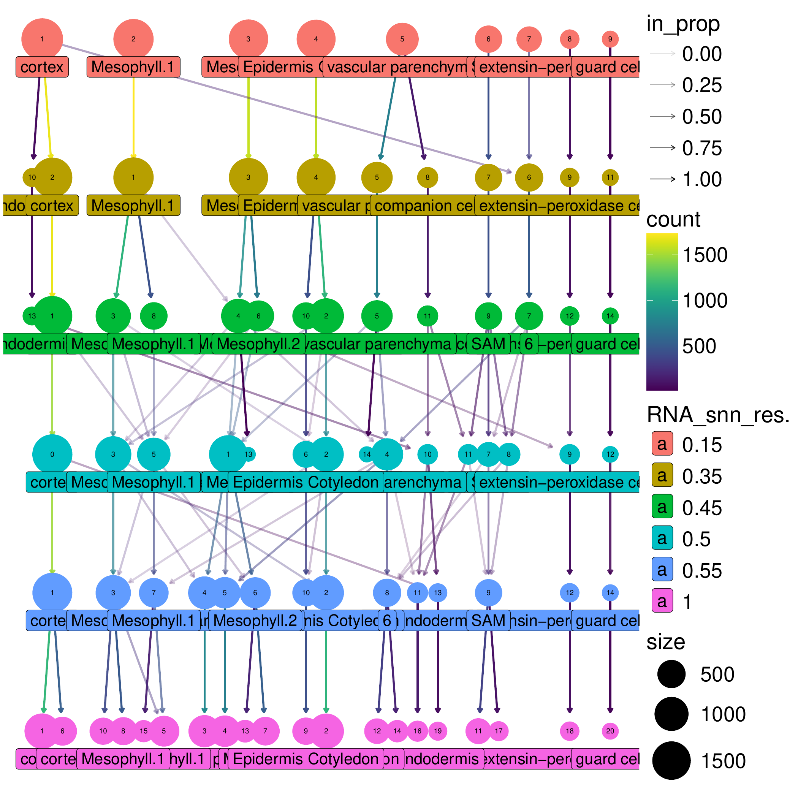{width=30%}


## Supplementary Section S2 - Cell-type grouping {-}

This optional section simplifies annotation labels by merging selected cell types
or subclusters into broader groups. It uses the `grouping` object as a small
renaming table: the names on the left are the current labels, and the values on
the right are the new labels.

For example, in this report the two mesophyll subclusters, `Mesophyll.1` and
`.2`, are renamed as `Mesophyll`. Any cell type that is not listed in `grouping` keeps its
original label.

Use this section when the detailed annotation is useful for inspection but a
simpler grouping is better for figures or downstream summaries. The grouped
labels are stored in `celltype_grouped`, and the grouped UMAP is saved as
`results/05_curation/umap_grouped.pdf`.

```{r supp_s2_cell_type_grouping_optional, strip_comments=FALSE}
# Merge the two mesophyll subclusters into a single label
grouping <- c(
  "Mesophyll.1" = "Mesophyll",
  "Mesophyll.2" = "Mesophyll"
)

output_dir <- dir_05

if (length(grouping) > 0) {
  current <- as.character(ath_sc$celltype)
  ath_sc$celltype_grouped <- ifelse(current %in% names(grouping), grouping[current], current)
} else {
  ath_sc$celltype_grouped <- ath_sc$celltype
}

save_pdf(
  plot_umap(ath_sc, "celltype_grouped"),
  "umap_grouped.pdf"
)

message("\nOK SUPPLEMENTARY S2 COMPLETE: cell-type grouping complete")
```

Representative output from Supplementary Section S2:

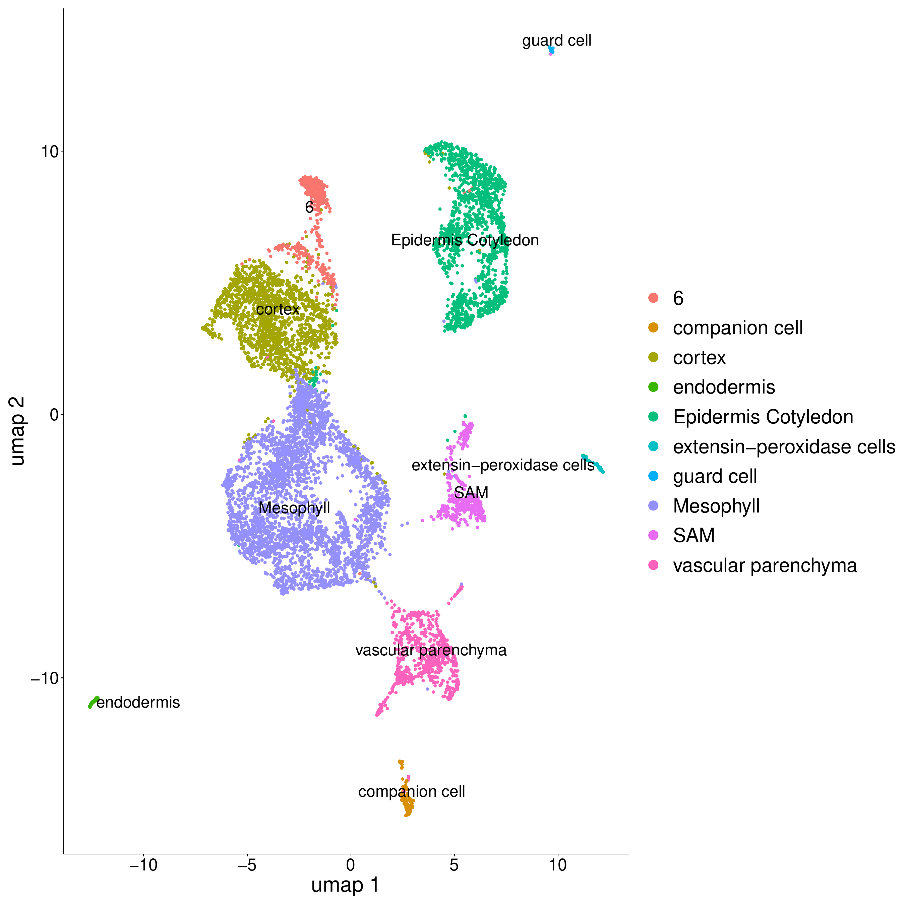{width=30%}


## Supplementary Section S3 - Subcluster inspection and manual curation {-}

This optional section is for manual curation when one annotated cluster needs a
closer look. First, `inspect_subcluster_markers()` takes one cluster, splits it
into smaller subclusters, and saves a figure with the subcluster UMAP and marker
gene patterns. This helps decide whether the original label should be kept or
refined.

If refinement is needed, `reassign` is edited as a small mapping table. The outer
name is the cluster being curated, the names inside are subcluster IDs, and the
values are the new labels. The special label `others` is used for any subcluster
not listed explicitly.

In this example the inspected cluster is `Mesophyll.1`, one of the two mesophyll
subclusters that Supplementary Section S2 merges into `Mesophyll`. The inspection
confirms the original label, so `reassign` maps every Mesophyll subcluster back to
`"Mesophyll"` and no cell is relabeled; this is the pattern to use when the
inspection shows that the original annotation was already correct.

The names of `reassign` are looked up in the column given by `annot_col`. Because
`Mesophyll` is a label of `celltype_grouped` (created in Supplementary Section S2)
and not of `celltype`, which only has `Mesophyll.1` and `Mesophyll.2`, the call uses
`annot_col = "celltype_grouped"`; S2 must be run first, otherwise the function stops
with a message that says so.

Then `curate_clusters()` applies those manual labels and stores the result in
`celltype_curated`. The final curated UMAP is saved as
`results/05_curation/umap_curated.pdf`. This block is not executed automatically
because the label choices depend on inspecting the figures.

```{r supp_s3_interactive_cell_type_curation_optional, eval=FALSE, strip_comments=FALSE}
output_dir <- dir_05
Idents(ath_sc) <- "celltype"

# 1. Inspect a cluster (saves the combined subcluster + marker figure)
inspect_subcluster_markers(
  ath_sc, cluster_id = "Mesophyll.1",
  marker_table = marker_table, output_dir = output_dir
)

# 2. Map each cluster's subclusters to labels ("others" = any ID not listed),
#    then curate them in one call. Here Mesophyll's subclusters all map back
#    to "Mesophyll" (no relabeling), which is the pattern to use when the
#    subcluster inspection confirms the original label was already correct.
#    The keys of `reassign` are labels of celltype_grouped (created in
#    Supplementary Section S2), so annot_col and source_col point to that column:
reassign <- list(
  "Mesophyll" = c("others" = "Mesophyll")
)
ath_sc <- curate_clusters(
  ath_sc, reassign,
  marker_table = marker_table, output_dir = output_dir,
  annot_col = "celltype_grouped", source_col = "celltype_grouped"
)

# 3. Save the curated annotation UMAP
save_pdf(
  plot_umap(ath_sc, "celltype_curated"),
  "umap_curated.pdf"
)

message("\nOK SUPPLEMENTARY S3 COMPLETE: curation complete")
```

Representative output from Supplementary Section S3 — subcluster inspection of the
Mesophyll population (UMAP of its subclusters plus marker-gene panels used to
decide whether to keep or split the label):

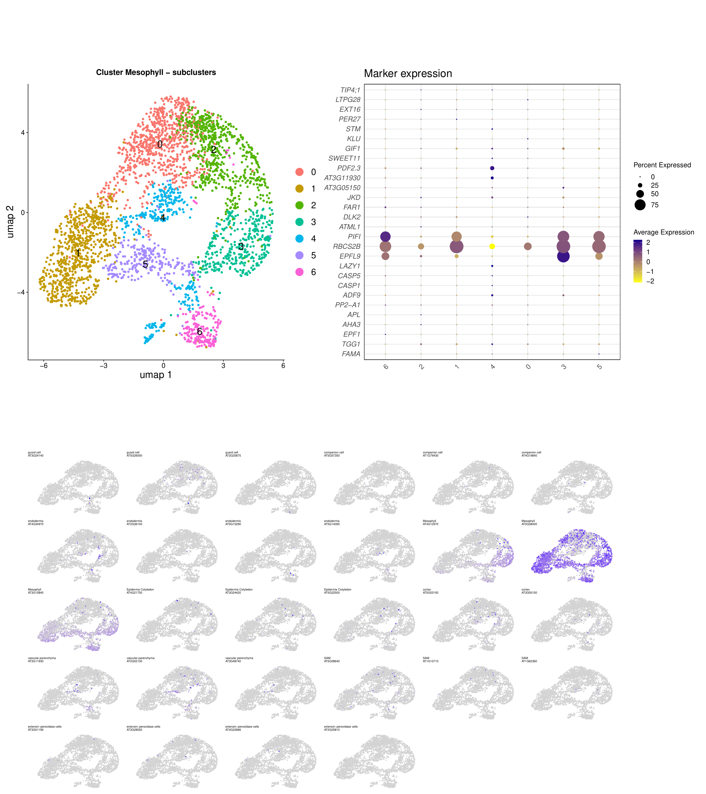{width=45%}

*In this example the Mesophyll subclusters are mapped back to `Mesophyll` (no
relabeling), which shows the inspect-then-curate mechanism without changing any
label. The main workflow does not need this step: it continues with the labels
from Section 7.*

\newpage

## Supplementary Section S4 - Manual root override {-}

If the automatic root selection (Section 21) does not match the expected
biological starting point, the root can be set manually by specifying a tree
node number. This requires two runs:

1. **First run with `auto`:** Run the trajectory with default settings. The
   pipeline generates an FA (ForceAtlas2) plot showing the tree structure with
   numbered nodes at each tip. Inspect this plot to identify which tip
   corresponds to the biological root (e.g., the progenitor population).

2. **Second run with `tip`:** Re-run with `root_method = "tip"` and `root_tip`
   set to the node number identified in step 1.

```python
# Example: re-run with manual root at node 42
adata_traj, selected_trajectory_dir, trajectory_runs = run_trajectory_runs(
    adata           = adata,
    clusters        = TRAJECTORY_CLUSTERS,
    root_cluster    = ROOT_CLUSTER,
    annotation_col  = ANNOTATION_COL,
    root_method     = "tip",
    root_tip        = 42,  # node number from FA plot
)
```

This approach is useful when the Gulati score (number of detected genes) does
not correctly identify the progenitor population, for example in datasets where
differentiated cells have higher transcriptional diversity than progenitors.

\newpage

# Supplementary Table — Software dependencies and versions {-}

Package versions are those bundled in the `psblab/scrnaseq:latest` Docker image
(the public image used for all R and Python steps). R **base-priority** packages
are omitted. Cell Ranger is 10x Genomics proprietary software run *outside* the
container (Part 1); its version is fixed by the workflow.

## Interpreters and command-line tools {-}

| Tool | Version |
|:-----|:--------|
| Cell Ranger | 9.0.1 |
| R | 4.5.3 |
| Python | 3.12.3 |

## Installing tmux or screen {-}

**tmux:** see the official installation guide at https://github.com/tmux/tmux/wiki/Installing
maintained by the tmux developers. This is the authoritative source for
platform-specific instructions (Linux package managers, macOS Homebrew/MacPorts,
BSD ports, building from source, and Windows via WSL2). The wiki is kept
up-to-date with each release and covers edge cases not listed here.

**screen:** `sudo apt install screen` (Debian/Ubuntu), `sudo yum install screen`
(RHEL/CentOS/Fedora), or ships with macOS by default.

Windows users: this whole pipeline (Cell Ranger, Docker/Singularity, R,
Python) is Linux-based. The practical options on Windows are WSL2
(https://learn.microsoft.com/windows/wsl/install) running Ubuntu locally, or
an SSH client (Windows Terminal, PuTTY, or WSL2's own `ssh`) connecting out to
a Linux server or HPC cluster where the rest of this guide applies directly.
Once inside WSL2 or an SSH session on Linux, use the commands above.

## Installing a container runtime (Docker or Singularity/Apptainer) {-}

Pick one; both run the same `psblab/scrnaseq:latest` image (see "Container
startup" in Part 1).

**Docker**

| OS | Install |
|---|---|
| Linux | https://docs.docker.com/engine/install/ (distro-specific packages) |
| macOS | Docker Desktop: https://docs.docker.com/desktop/install/mac-install/ |
| Windows | Docker Desktop with the WSL2 backend: https://docs.docker.com/desktop/install/windows-install/ |

**Singularity / Apptainer** (no root required; common on HPC clusters where
Docker is not permitted)

| OS | Install |
|---|---|
| Linux | https://apptainer.org/docs/admin/main/installation.html |
| macOS / Windows | not natively supported — use a Linux VM, WSL2, or the remote server/cluster itself |

On a shared HPC cluster, Singularity/Apptainer is usually already installed
system-wide — check with `singularity --version` or `apptainer --version`
before installing anything.

## Troubleshooting Singularity/Apptainer {-}

**Symptom.** `singularity build` finishes, but the startup command
(`singularity exec ... scrnaseq.sif /bin/bash`) fails with `squashfuse not
found` followed by `Operation not permitted` during extraction.

**Cause.** A `.sif` file is a compressed (squashfs) filesystem that must be
mounted to run. Where Apptainer is installed with its setuid helper (common on
shared clusters), this works with no further setup. In a rootless installation
without that helper, Apptainer mounts the image through FUSE using
`squashfuse`; if it is missing, Apptainer falls back to extracting the image,
which fails when user namespaces are disabled or restricted, or when the
temporary directory is unusable.

**Prerequisite check.** Run these three commands:

```bash
apptainer --version                        # must print a version number
which squashfuse fusermount                # must print a path for both programs
cat /proc/sys/user/max_user_namespaces     # must print a number greater than 0
```

The first command must always work. If Apptainer was installed with its setuid
helper (common on shared clusters), nothing else is needed. Otherwise the
second command must print a path for both programs, and the third must print a
number greater than 0. If either is missing, the error above is expected.

**Fixes, in order of effort.**

1. Install `squashfuse` and `fuse` (on a cluster, ask the administrators).
2. Point Apptainer to a local disk with free space that is not mounted
   `noexec`, then retry:

```bash
export APPTAINER_TMPDIR=/path/to/local/disk/tmp
export APPTAINER_CACHEDIR=/path/to/local/disk/cache
mkdir -p "$APPTAINER_TMPDIR" "$APPTAINER_CACHEDIR"
```

3. Avoid mounting by building a directory instead of a `.sif`, and run that:

```bash
apptainer build --sandbox scrnaseq/ docker://psblab/scrnaseq:latest
apptainer exec --bind $(pwd):/workspace --pwd /workspace scrnaseq/ /bin/bash
```

4. If none of these work, contact your system administrators, or use Docker
   (Option B) on a machine where it is permitted.

On Ubuntu 24.04 and similar distributions, AppArmor can restrict unprivileged
user namespaces by default; this requires an administrator to allow Apptainer.

## R packages (421) {-}

**Note on package versions:** The tables below list the package versions installed
in the `psblab/scrnaseq:latest` container image at the time of writing. These
versions are locked inside the container, so anyone who pulls the image gets
exactly these versions — there is nothing to install manually. **The authoritative
source is the container itself**, not this list; if the image is updated in the
future, the container's installed versions take precedence. To inspect the current
versions inside a running container, use `R -e "installed.packages()[,3]"` for R
or `pip list` for Python.

```{=latex}
\footnotesize
```
| Package | Version | Package | Version |
|:--------|:--------|:--------|:--------|
| `abind` | 1.4-8 | `locfit` | 1.5-9.12 |
| `anndataR` | 1.0.2 | `lubridate` | 1.9.5 |
| `AnnotationDbi` | 1.72.0 | `magrittr` | 2.0.5 |
| `ape` | 5.8-1 | `maps` | 3.4.3 |
| `aplot` | 0.2.9 | `MASS` | 7.3-65 |
| `askpass` | 1.2.1 | `Matrix` | 1.7-5 |
| `assertthat` | 0.2.1 | `MatrixGenerics` | 1.22.0 |
| `assorthead` | 1.4.0 | `MatrixModels` | 0.5-4 |
| `backports` | 1.5.1 | `matrixStats` | 1.5.0 |
| `base64enc` | 0.1-6 | `memoise` | 2.0.1 |
| `basilisk` | 1.22.0 | `mgcv` | 1.9-4 |
| `batchelor` | 1.26.0 | `microbenchmark` | 1.5.0 |
| `beachmat` | 2.26.0 | `mime` | 0.13 |
| `beeswarm` | 0.4.0 | `miniUI` | 0.1.2 |
| `BH` | 1.90.0-1 | `minqa` | 1.2.8 |
| `biglm` | 0.9-3 | `modelr` | 0.1.11 |
| `Biobase` | 2.70.0 | `monocle3` | 1.4.27 |
| `BiocGenerics` | 0.56.0 | `nlme` | 3.1-169 |
| `BiocManager` | 1.30.27 | `nloptr` | 2.2.1 |
| `BiocNeighbors` | 2.4.0 | `nnet` | 7.3-20 |
| `BiocParallel` | 1.44.0 | `numDeriv` | 2016.8-1.1 |
| `BiocSingular` | 1.26.1 | `openssl` | 2.4.1 |
| `BiocVersion` | 3.22.0 | `org.At.tair.db` | 3.22.0 |
| `Biostrings` | 2.78.0 | `otel` | 0.2.0 |
| `bit` | 4.6.0 | `pak` | 0.9.5 |
| `bit64` | 4.8.2 | `parallelly` | 1.47.0 |
| `bitops` | 1.0-9 | `patchwork` | 1.3.2 |
| `blob` | 1.3.0 | `pbapply` | 1.7-4 |
| `boot` | 1.3-32 | `pbkrtest` | 0.5.5 |
| `BPCells` | 0.3.1 | `pbmcapply` | 1.5.1 |
| `brew` | 1.0-10 | `pheatmap` | 1.0.13 |
| `brio` | 1.1.5 | `pillar` | 1.11.1 |
| `broom` | 1.0.13 | `pkgbuild` | 1.4.8 |
| `bslib` | 0.11.0 | `pkgconfig` | 2.0.3 |
| `cachem` | 1.1.0 | `pkgdown` | 2.2.0 |
| `Cairo` | 1.7-0 | `pkgload` | 1.5.2 |
| `callr` | 3.7.6 | `plotly` | 4.12.0 |
| `car` | 3.1-5 | `plyr` | 1.8.9 |
| `carData` | 3.0-6 | `png` | 0.1-9 |
| `caTools` | 1.18.3 | `polyclip` | 1.10-7 |
| `cellranger` | 1.1.0 | `polynom` | 1.4-1 |
| `checkmate` | 2.3.4 | `praise` | 1.0.0 |
| `circlize` | 0.4.18 | `preprocessCore` | 1.72.0 |
| `class` | 7.3-23 | `prettyunits` | 1.2.0 |
| `classInt` | 0.4-11 | `processx` | 3.9.0 |
| `cli` | 3.6.6 | `profvis` | 0.4.0 |
| `clipr` | 0.8.1 | `progress` | 1.2.3 |
| `clue` | 0.3-68 | `progressr` | 0.19.0 |
| `cluster` | 2.1.8.2 | `promises` | 1.5.0 |
| `clusterProfiler` | 4.18.4 | `proxy` | 0.4-29 |
| `clustree` | 0.5.1 | `ps` | 1.9.3 |
| `codetools` | 0.2-20 | `pscl` | 1.5.9 |
| `colorspace` | 2.1-2 | `purrr` | 1.2.2 |
| `commonmark` | 2.0.0 | `quadprog` | 1.5-8 |
| `ComplexHeatmap` | 2.26.1 | `quantreg` | 6.1 |
| `conflicted` | 1.2.0 | `qvalue` | 2.42.0 |
| `corrplot` | 0.95 | `R.methodsS3` | 1.8.2 |
| `cowplot` | 1.2.0 | `R.oo` | 1.27.1 |
| `cpp11` | 0.5.5 | `R.utils` | 2.13.0 |
| `crayon` | 1.5.3 | `R6` | 2.6.1 |
| `credentials` | 2.0.3 | `ragg` | 1.5.2 |
| `crosstalk` | 1.2.2 | `RANN` | 2.6.2 |
| `curl` | 7.1.0 | `rappdirs` | 0.3.4 |
| `data.table` | 1.18.4 | `rbibutils` | 2.4.1 |
| `DBI` | 1.3.0 | `rcmdcheck` | 1.4.0 |
| `dbplyr` | 2.5.2 | `RColorBrewer` | 1.1-3 |
| `DelayedArray` | 0.36.1 | `Rcpp` | 1.1.1-1.1 |
| `DelayedMatrixStats` | 1.32.0 | `RcppAnnoy` | 0.0.23 |
| `deldir` | 2.0-4 | `RcppArmadillo` | 15.2.7-1 |
| `Deriv` | 4.2.0 | `RcppEigen` | 0.3.4.0.2 |
| `desc` | 1.4.3 | `RcppHNSW` | 0.7.0 |
| `DESeq2` | 1.50.2 | `RcppML` | 0.3.7.1 |
| `devtools` | 2.5.2 | `RcppProgress` | 0.4.2 |
| `diffobj` | 0.3.6 | `RcppRoll` | 0.3.2 |
| `digest` | 0.6.39 | `RcppTOML` | 0.2.3 |
| `dir.expiry` | 1.18.0 | `Rdpack` | 2.6.6 |
| `distributional` | 0.7.0 | `readr` | 2.2.0 |
| `doBy` | 4.7.1 | `readxl` | 1.5.0 |
| `docopt` | 0.7.2 | `reformulas` | 0.4.4 |
| `doParallel` | 1.0.17 | `rematch` | 2.0.0 |
| `DOSE` | 4.4.0 | `rematch2` | 2.1.2 |
| `dotCall64` | 1.2 | `remotes` | 2.5.0 |
| `DoubletFinder` | 2.0.6 | `reprex` | 2.1.1 |
| `downlit` | 0.4.5 | `reshape2` | 1.4.5 |
| `dplyr` | 1.2.1 | `ResidualMatrix` | 1.20.0 |
| `dqrng` | 0.4.1 | `reticulate` | 1.46.0 |
| `dtplyr` | 1.3.3 | `rhdf5` | 2.54.1 |
| `dynamicTreeCut` | 1.63-1 | `rhdf5filters` | 1.22.0 |
| `e1071` | 1.7-17 | `Rhdf5lib` | 1.32.0 |
| `ellipsis` | 0.3.3 | `RhpcBLASctl` | 0.23-42 |
| `enrichplot` | 1.30.5 | `Rhtslib` | 3.6.0 |
| `enrichR` | 3.4 | `rjson` | 0.2.23 |
| `eulerr` | 8.0.0 | `rlang` | 1.2.0 |
| `evaluate` | 1.0.5 | `rmarkdown` | 2.31 |
| `fansi` | 1.0.7 | `ROCR` | 1.0-12 |
| `farver` | 2.1.2 | `roxygen2` | 8.0.0 |
| `fastcluster` | 1.3.0 | `rpart` | 4.1.24 |
| `fastDummies` | 1.7.6 | `rprojroot` | 2.1.1 |
| `fastmap` | 1.2.0 | `rsample` | 1.3.2 |
| `fastmatch` | 1.1-8 | `Rsamtools` | 2.26.0 |
| `fgsea` | 1.36.2 | `RSpectra` | 0.16-2 |
| `fields` | 17.3 | `RSQLite` | 3.53.1 |
| `filelock` | 1.0.3 | `rstatix` | 0.7.3 |
| `fitdistrplus` | 1.2-6 | `rstudioapi` | 0.18.0 |
| `FNN` | 1.1.4.1 | `rsvd` | 1.0.5 |
| `fontawesome` | 0.5.3 | `Rtsne` | 0.17 |
| `fontBitstreamVera` | 0.1.1 | `rversions` | 3.0.0 |
| `fontLiberation` | 0.1.0 | `rvest` | 1.0.5 |
| `fontquiver` | 0.2.1 | `s2` | 1.1.11 |
| `forcats` | 1.0.1 | `S4Arrays` | 1.10.1 |
| `foreach` | 1.5.2 | `S4Vectors` | 0.48.1 |
| `forecast` | 9.0.2 | `S7` | 0.2.2 |
| `foreign` | 0.8-91 | `sass` | 0.4.10 |
| `formatR` | 1.14 | `ScaledMatrix` | 1.18.0 |
| `Formula` | 1.2-5 | `scales` | 1.4.0 |
| `fracdiff` | 1.5-4 | `scater` | 1.38.1 |
| `fs` | 2.1.0 | `scattermore` | 1.2 |
| `furrr` | 0.4.0 | `scatterpie` | 0.2.6 |
| `futile.logger` | 1.4.9 | `sctransform` | 0.4.3 |
| `futile.options` | 1.0.1 | `scuttle` | 1.20.0 |
| `future` | 1.70.0 | `selectr` | 0.5-1 |
| `future.apply` | 1.20.2 | `Seqinfo` | 1.0.0 |
| `gargle` | 1.6.1 | `sessioninfo` | 1.2.3 |
| `gdtools` | 0.5.1 | `Seurat` | 5.5.0 |
| `GeneOverlap` | 1.46.0 | `SeuratDisk` | 0.0.0.9021 |
| `generics` | 0.1.4 | `SeuratObject` | 5.4.0 |
| `GENIE3` | 1.32.0 | `SeuratWrappers` | 0.4.0 |
| `GenomeInfoDb` | 1.46.2 | `sf` | 1.1-1 |
| `GenomicRanges` | 1.62.1 | `shape` | 1.4.6.1 |
| `gert` | 2.3.1 | `shiny` | 1.13.0 |
| `GetoptLong` | 1.1.1 | `SingleCellExperiment` | 1.32.0 |
| `ggbeeswarm` | 0.7.3 | `sitmo` | 2.0.2 |
| `ggdist` | 3.3.3 | `slam` | 0.1-55 |
| `ggforce` | 0.5.0 | `slider` | 0.3.3 |
| `ggfun` | 0.2.0 | `snow` | 0.4-4 |
| `ggiraph` | 0.9.6 | `sourcetools` | 0.1.7-2 |
| `ggnewscale` | 0.5.2 | `sp` | 2.2-1 |
| `ggplot2` | 4.0.3 | `spam` | 2.11-4 |
| `ggplotify` | 0.1.3 | `SparseArray` | 1.10.10 |
| `ggpubr` | 0.6.3 | `SparseM` | 1.84-2 |
| `ggraph` | 2.2.2 | `sparseMatrixStats` | 1.22.0 |
| `ggrastr` | 1.0.2 | `spatial` | 7.3-18 |
| `ggrepel` | 0.9.8 | `spatstat.data` | 3.1-9 |
| `ggridges` | 0.5.7 | `spatstat.explore` | 3.8-1 |
| `ggsci` | 5.0.0 | `spatstat.geom` | 3.8-1 |
| `ggsignif` | 0.6.4 | `spatstat.random` | 3.5-0 |
| `ggtangle` | 0.1.2 | `spatstat.sparse` | 3.2-0 |
| `ggtree` | 4.0.5 | `spatstat.univar` | 3.2-0 |
| `ggvenn` | 0.1.19 | `spatstat.utils` | 3.2-3 |
| `gh` | 1.6.0 | `spData` | 2.3.5 |
| `gitcreds` | 0.1.2 | `spdep` | 1.4-2 |
| `GlobalOptions` | 0.1.4 | `speedglm` | 0.3-4 |
| `globals` | 0.19.1 | `statmod` | 1.5.2 |
| `glue` | 1.8.1 | `stringi` | 1.8.7 |
| `GO.db` | 3.22.0 | `stringr` | 1.6.0 |
| `goftest` | 1.2-3 | `SummarizedExperiment` | 1.40.0 |
| `googledrive` | 2.1.2 | `survival` | 3.8-6 |
| `googlesheets4` | 1.1.2 | `svglite` | 2.2.2 |
| `GOSemSim` | 2.36.0 | `sys` | 3.4.3 |
| `gplots` | 3.3.0 | `systemfonts` | 1.3.2 |
| `graphlayouts` | 1.2.3 | `tensor` | 1.5.1 |
| `gridExtra` | 2.3 | `tester` | 0.3.0 |
| `gridGraphics` | 0.5-1 | `testthat` | 3.3.2 |
| `grr` | 0.9.5 | `textshaping` | 1.0.5 |
| `gson` | 0.1.0 | `tibble` | 3.3.1 |
| `gtable` | 0.3.6 | `tidydr` | 0.0.6 |
| `gtools` | 3.9.5 | `tidygraph` | 1.3.1 |
| `h5mread` | 1.2.1 | `tidyr` | 1.3.2 |
| `harmony` | 2.0.3 | `tidyselect` | 1.2.1 |
| `haven` | 2.5.5 | `tidytree` | 0.4.7 |
| `HDF5Array` | 1.38.0 | `tidyverse` | 2.0.0 |
| `hdf5r` | 1.3.12 | `timechange` | 0.4.0 |
| `hdWGCNA` | 0.4.11 | `timeDate` | 4052.112 |
| `here` | 1.0.2 | `tinytex` | 0.59 |
| `hexbin` | 1.28.5 | `treeio` | 1.34.0 |
| `highr` | 0.12 | `tweenr` | 2.0.3 |
| `Hmisc` | 5.2-5 | `tzdb` | 0.5.0 |
| `hms` | 1.1.4 | `UCell` | 2.14.0 |
| `htmlTable` | 2.5.0 | `UCSC.utils` | 1.6.1 |
| `htmltools` | 0.5.9 | `units` | 1.0-1 |
| `htmlwidgets` | 1.6.4 | `UpSetR` | 1.4.1 |
| `httpuv` | 1.6.17 | `urca` | 1.3-4 |
| `httr` | 1.4.8 | `urlchecker` | 1.0.1 |
| `httr2` | 1.2.2 | `usethis` | 3.2.1 |
| `ica` | 1.0-3 | `utf8` | 1.2.6 |
| `ids` | 1.0.1 | `uuid` | 1.2-2 |
| `igraph` | 2.3.2 | `uwot` | 0.2.4 |
| `impute` | 1.84.0 | `vctrs` | 0.7.3 |
| `ini` | 0.3.1 | `VennDiagram` | 1.8.2 |
| `IRanges` | 2.44.0 | `vipor` | 0.4.7 |
| `irlba` | 2.3.7 | `viridis` | 0.6.5 |
| `isoband` | 0.3.0 | `viridisLite` | 0.4.3 |
| `iterators` | 1.0.14 | `vroom` | 1.7.1 |
| `jquerylib` | 0.1.4 | `waldo` | 0.6.2 |
| `jsonlite` | 2.0.0 | `warp` | 0.2.3 |
| `kableExtra` | 1.4.0 | `WGCNA` | 1.74 |
| `KEGGREST` | 1.50.0 | `whisker` | 0.4.1 |
| `KernSmooth` | 2.23-26 | `withr` | 3.0.2 |
| `knitr` | 1.51 | `wk` | 0.9.5 |
| `labeling` | 0.4.3 | `WriteXLS` | 6.8.0 |
| `lambda.r` | 1.2.4 | `xfun` | 0.58 |
| `later` | 1.4.8 | `xml2` | 1.5.2 |
| `lattice` | 0.22-9 | `xopen` | 1.0.1 |
| `lazyeval` | 0.2.3 | `xtable` | 1.8-8 |
| `leidenbase` | 0.1.37 | `XVector` | 0.50.0 |
| `lifecycle` | 1.0.5 | `yaml` | 2.3.12 |
| `limma` | 3.66.0 | `yulab.utils` | 0.2.4 |
| `listenv` | 0.10.1 | `zellkonverter` | 1.20.1 |
| `littler` | 0.3.23 | `zip` | 2.3.3 |
| `lme4` | 2.0-1 | `zoo` | 1.8-15 |
| `lmtest` | 0.9-40 |  | |
```{=latex}
\normalsize
```


## Python packages (207) {-}


```{=latex}
\footnotesize
```
| Package | Version | Package | Version |
|:--------|:--------|:--------|:--------|
| `adjustText` | 1.3.0 | `notebook` | 6.5.7 |
| `anndata` | 0.12.16 | `notebook_shim` | 0.2.4 |
| `annotated-types` | 0.7.0 | `numba` | 0.65.1 |
| `anyio` | 4.13.0 | `numcodecs` | 0.16.5 |
| `argon2-cffi` | 25.1.0 | `numexpr` | 2.14.1 |
| `argon2-cffi-bindings` | 25.1.0 | `numpy` | 2.4.6 |
| `array-api-compat` | 1.14.0 | `numpy-groupies` | 0.11.3 |
| `arrow` | 1.4.0 | `nvidia-cublas` | 13.1.1.3 |
| `asttokens` | 3.0.1 | `nvidia-cuda-cupti` | 13.0.85 |
| `async-lru` | 2.3.0 | `nvidia-cuda-nvrtc` | 13.0.88 |
| `attrs` | 26.1.0 | `nvidia-cuda-runtime` | 13.0.96 |
| `babel` | 2.18.0 | `nvidia-cudnn-cu13` | 9.20.0.48 |
| `beautifulsoup4` | 4.14.3 | `nvidia-cufft` | 12.0.0.61 |
| `bleach` | 6.3.0 | `nvidia-cufile` | 1.15.1.6 |
| `blosc2` | 4.4.1 | `nvidia-curand` | 10.4.0.35 |
| `cellbender` | 0.3.2 | `nvidia-cusolver` | 12.0.4.66 |
| `certifi` | 2026.5.20 | `nvidia-cusparse` | 12.6.3.3 |
| `cffi` | 2.0.0 | `nvidia-cusparselt-cu13` | 0.8.1 |
| `charset-normalizer` | 3.4.7 | `nvidia-nccl-cu13` | 2.29.7 |
| `click` | 8.4.1 | `nvidia-nvjitlink` | 13.0.88 |
| `comm` | 0.2.3 | `nvidia-nvshmem-cu13` | 3.4.5 |
| `contourpy` | 1.3.3 | `nvidia-nvtx` | 13.0.85 |
| `cuda-bindings` | 13.3.1 | `opt_einsum` | 3.4.0 |
| `cuda-pathfinder` | 1.5.5 | `packaging` | 26.2 |
| `cuda-toolkit` | 13.0.2 | `palantir` | 1.4.4 |
| `cycler` | 0.12.1 | `pandas` | 2.3.3 |
| `debugpy` | 1.8.21 | `pandocfilters` | 1.5.1 |
| `decorator` | 5.3.1 | `parso` | 0.8.7 |
| `defusedxml` | 0.7.1 | `patsy` | 1.0.2 |
| `donfig` | 0.8.1.post1 | `pexpect` | 4.9.0 |
| `elpigraph-python` | 0.3.4 | `pillow` | 12.2.0 |
| `entrypoints` | 0.4 | `pip` | 26.1.2 |
| `executing` | 2.2.1 | `platformdirs` | 4.10.0 |
| `fa2_modified` | 0.4 | `plotly` | 6.7.0 |
| `fast-array-utils` | 1.4.1 | `prometheus_client` | 0.25.0 |
| `fastjsonschema` | 2.21.2 | `prompt_toolkit` | 3.0.52 |
| `filelock` | 3.29.0 | `psutil` | 7.2.2 |
| `fonttools` | 4.63.0 | `ptyprocess` | 0.7.0 |
| `fqdn` | 1.5.1 | `pure_eval` | 0.2.3 |
| `fsspec` | 2026.4.0 | `py-cpuinfo` | 9.0.0 |
| `google-crc32c` | 1.8.0 | `pycparser` | 3.0 |
| `h11` | 0.16.0 | `pydantic` | 2.13.4 |
| `h5py` | 3.16.0 | `pydantic_core` | 2.46.4 |
| `httpcore` | 1.0.9 | `Pygments` | 2.20.0 |
| `httpx` | 0.28.1 | `pynndescent` | 0.6.0 |
| `idna` | 3.18 | `pyparsing` | 3.3.2 |
| `igraph` | 1.0.0 | `pyro-api` | 0.1.2 |
| `ipykernel` | 6.29.5 | `pyro-ppl` | 1.9.1 |
| `ipython` | 9.14.0 | `python-dateutil` | 2.9.0.post0 |
| `ipython-genutils` | 0.2.0 | `python-igraph` | 1.0.0 |
| `ipython_pygments_lexers` | 1.1.1 | `python-json-logger` | 4.1.0 |
| `ipywidgets` | 8.1.8 | `pytz` | 2026.2 |
| `isoduration` | 20.11.0 | `PyYAML` | 6.0.3 |
| `jax` | 0.10.1 | `pyzmq` | 27.1.0 |
| `jaxlib` | 0.10.1 | `referencing` | 0.37.0 |
| `jaxopt` | 0.8.5 | `requests` | 2.34.2 |
| `jedi` | 0.20.0 | `rfc3339-validator` | 0.1.4 |
| `Jinja2` | 3.1.6 | `rfc3986-validator` | 0.1.1 |
| `joblib` | 1.5.3 | `rfc3987-syntax` | 1.1.0 |
| `json5` | 0.14.0 | `rpds-py` | 2026.5.1 |
| `jsonpointer` | 3.1.1 | `rpy2` | 3.6.7 |
| `jsonschema` | 4.26.0 | `rpy2-rinterface` | 3.6.6 |
| `jsonschema-specifications` | 2025.9.1 | `rpy2-robjects` | 3.6.5 |
| `jupyter` | 1.1.1 | `scanpy` | 1.12.1 |
| `jupyter-console` | 6.6.3 | `scFates` | 1.2.4 |
| `jupyter-events` | 0.12.1 | `scikit-learn` | 1.9.0 |
| `jupyter-highlight-selected-word` | 0.2.0 | `scikit-misc` | 0.5.2 |
| `jupyter-lsp` | 2.3.1 | `scipy` | 1.17.1 |
| `jupyter_client` | 7.4.9 | `scverse-misc` | 0.0.7 |
| `jupyter_contrib_core` | 0.4.2 | `seaborn` | 0.13.2 |
| `jupyter_contrib_nbextensions` | 0.7.0 | `Send2Trash` | 2.1.0 |
| `jupyter_core` | 5.9.1 | `session-info2` | 0.4.1 |
| `jupyter_nbextensions_configurator` | 0.6.4 | `setuptools` | 81.0.0 |
| `jupyter_server` | 2.19.0 | `shapely` | 2.1.2 |
| `jupyter_server_terminals` | 0.5.4 | `simpleppt` | 1.1.7 |
| `jupyterlab` | 4.5.7 | `six` | 1.17.0 |
| `jupyterlab_pygments` | 0.3.0 | `soupsieve` | 2.8.4 |
| `jupyterlab_server` | 2.28.0 | `stack-data` | 0.6.3 |
| `jupyterlab_widgets` | 3.0.16 | `statsmodels` | 0.14.6 |
| `kiwisolver` | 1.5.0 | `sympy` | 1.14.0 |
| `lark` | 1.3.1 | `tables` | 3.11.1 |
| `legacy-api-wrap` | 1.5 | `terminado` | 0.18.1 |
| `leidenalg` | 0.12.0 | `texttable` | 1.7.0 |
| `llvmlite` | 0.47.0 | `threadpoolctl` | 3.6.0 |
| `loompy` | 3.0.8 | `tinycss2` | 1.5.1 |
| `lxml` | 6.1.1 | `torch` | 2.12.0 |
| `lxml_html_clean` | 0.4.5 | `tornado` | 6.5.6 |
| `MarkupSafe` | 3.0.3 | `tqdm` | 4.67.3 |
| `matplotlib` | 3.10.9 | `traitlets` | 5.15.0 |
| `matplotlib-inline` | 0.2.2 | `triton` | 3.7.0 |
| `mellon` | 1.7.1 | `typing-inspection` | 0.4.2 |
| `mistune` | 0.8.4 | `typing_extensions` | 4.15.0 |
| `ml_dtypes` | 0.5.4 | `tzdata` | 2026.2 |
| `mpmath` | 1.3.0 | `tzlocal` | 5.4.4 |
| `msgpack` | 1.1.2 | `umap-learn` | 0.5.12 |
| `narwhals` | 2.22.0 | `uri-template` | 1.3.0 |
| `natsort` | 8.4.0 | `urllib3` | 2.7.0 |
| `nbclassic` | 1.3.3 | `wcwidth` | 0.7.0 |
| `nbclient` | 0.10.4 | `webcolors` | 25.10.0 |
| `nbconvert` | 6.5.4 | `webencodings` | 0.5.1 |
| `nbformat` | 5.10.4 | `websocket-client` | 1.9.0 |
| `ndindex` | 1.10.1 | `widgetsnbextension` | 4.0.15 |
| `nest-asyncio` | 1.6.0 | `zarr` | 3.2.1 |
| `networkx` | 3.6.1 |  | |
```{=latex}
\normalsize
```

